# RemoteOps kapsamlı test ve inceleme raporu

15 Ekim 2026 · YD_RemoteOps.App_v27

## v27 - v26 kodu için hafif operasyon kabul testi

Bu teslim uygulama davranışını değiştirmez. RemoteOps.App ve Modules içindeki 36 üretim dosyası v26 ile birebir aynıdır. v26 kaynak ve ZIP korunmuştur. Yeni teslim hafif test araçları, kayıtlar ve kabul raporunu ekler.

Gerçek WPF reçete oluşturma, otomatik ad, adım içi koşul, kaydetme/yeniden açma, önizleme ve RECETE onayı; gerçek koordinatör ve çocuk süreçleriyle sınandı. Uzak erişim sınırında yerel, durumu değişen servis/registry modeli kullanıldı. 17/17 operasyon senaryosu, 12/12 yerel regresyon dosyası ve 5/5 sınır negatif kontrolü geçti. Bağımsız inceleme 16 çalışma kaydını doğruladı. Çalışma yaklaşık 149 saniye sürdü; gözlenen toplam çalışma belleği yaklaşık 700 MiB idi. Sanal makine kullanılmadı.

Yanıltıcı Success raporu hedef durumuyla ayrıca karşılaştırıldı ve reddedildi. Koşul atlama/durdurma, All/Any, okuma/işlem hatası, iptal, hedef bağımsızlığı ve eski ortak koşul davranışı doğrulandı. Gerçek ağ/Windows sağlayıcısı, domain hesabı, SMB/PsExec ve EDR testi yapılmadı. Durdur onay kutusu yerine aynı gerçek iptal isteği mekanizması çağrıldı.

[Ayrıntılı kabul raporu](V27_HAFIF_TEST_RAPORU.html) · [Kod eşitliği](V26_CODE_IDENTITY.json)

Tekrar çalıştırmak için kökte HAFIF_TEST_CALISTIR.bat dosyasını açın. Çıktılar yeni tarihli klasöre yazılır. Kişisel veri yolları testte geçici dizine yönlendirilir; gerçek uygulamanın C:\Temp\YD_RemoteOps.App ve AppData yolları değişmez.

## v26 arayüzü ve önceki teslimlerin referansı

Aşağıdaki ekran görüntüleri ve v26 açıklamaları aynı kalan uygulama arayüzünün referansıdır. v27 yalnızca test teslimidir.

15 Ekim 2026 · YD_RemoteOps.App_v26

## v26 - Adımın içinde koşul ve otomatik adlandırma

Reçete ekranı adım listesine odaklanır. İşlem alanlarını doldurmak için Adım ekle veya seçili adımı düzenleme komutunu kullanın. Düzenleme ayrı pencerede açılır; işlem bilgileri ve çalışma koşulu ayrı bölümlerde tutulur. Ana sayfada aşağı kaydırarak alan aramak gerekmez. Uzun listeler kendi alanında kaydırılabilir.

Adım adına ayrıca metin yazmak gerekmez. İşlem ve ilgili servis, dosya veya registry bilgileri adı oluşturur. Örneğin Servisi başlat · Spooler. İsterseniz adı özelleştirebilirsiniz; eski reçetelerde verdiğiniz özel adlar korunur.

İlgili adımın çalışma koşulunda servis veya registry kontrolü tanımlayın. Registry değerinde tür seçilmez: 1 veya 16.0.444 gibi beklenen değeri girin. Gerçek hedef türüne göre karşılaştırma yapılır. Servis koşulunda yalnızca servisle ilgili alanlar görünür. Birden fazla kontrol için Tümü / Herhangi biri davranışı korunur. Koşul sağlanmazsa adımı atlama veya hedefin reçetesini durdurma seçilebilir.

Otomatik adlandırma tercihi yeni Recipe/4 biçiminde saklanır; yeniden açıldığında da güncellenir. Eski reçeteler ve özel adlar korunur. Yeni biçimdeki reçeteleri açmak için v26 gerekir.

Mevcut ortak koşulların bağlı adımları ve tek kez değerlendirilme davranışı korunur. Eski ortak koşul değiştirilirse aynı koşula bağlı bütün adımları etkiler; düzenleyici bu kapsamı belirtir. Yeni koşullar ilgili işlemle birlikte yönetilir. Uyumsuz sıra değişiklikleri engellenir. Düzenlemeden vazgeçmek kayıtlı reçeteyi veya taslağı değiştirmez.

Hedefler ayrı bölümde yönetilir; ortak hedef araçları korunur. Reçeteyi kaydetmek hedefte işlem başlatmaz. Kaydedilmiş reçetenin önizlemesi ve RECETE çalıştırma onayı devam eder. Gerçek uzak hedef testi bu teslimde yapılmamıştır.

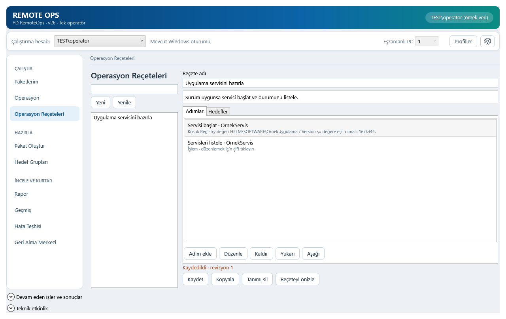

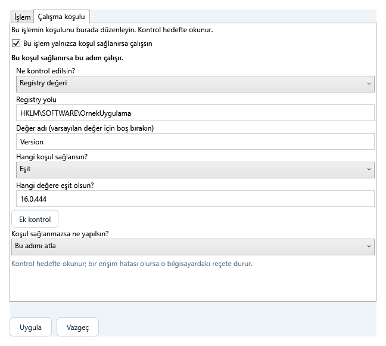

## Önceki sürümlerin tarihsel açıklamaları

Aşağıdaki v25 ve daha eski bölümler kendi teslimlerini anlatır. Güncel v26 kullanımında üstteki adım düzenleme akışı geçerlidir.

15 Ekim 2026 · YD_RemoteOps.App_v25

## v25 — Kolay koşul oluşturma ve otomatik değer karşılaştırması

Koşullar artık ayrı bir Koşul ekle düğmesi yerine Adım ekle akışındadır. Yeni adımın Adımda ne yapılsın? listesinden Koşul: Registry değerini kontrol et, Koşul: Registry anahtarını kontrol et veya Koşul: Servisi kontrol et seçilir. Servisi başlat/durdur/yeniden başlat normal bir işlemdir; servis koşulu salt okunur kontroldür.

Registry değeri için yalnızca yolu, değer adını, Eşit/Eşit değil seçimini ve karşılaştırılacak değeri girin. Örneğin Version için 16.0.444 veya Mode için 1 yazın. Registry türü seçilmez: uygulama hedefte kayıtlı gerçek türü okur ve girdiğinizi o türe göre karşılaştırır. Metin değeri metin olarak, sayı değeri sayı olarak ele alınır. Olası türler sırayla denenmez. Sürüm metni sayıya çevrilmez. Sayı türüne uymayan beklenen metin eşit değildir; hedef okunamadıysa bu bir karşılaştırma sonucu sayılmaz ve o bilgisayardaki reçete durur.

Registry anahtarı seçildiğinde yalnızca yol ve var/yok kontrolü görünür. Registry değeri için Var/Yok seçildiğinde beklenen değer alanı da kapanır. Değer adı boş bırakılırsa varsayılan registry değeri kullanılır. Eksik değer Eşit değil koşulunu sağlamaz; eksikliği denetlemek için Yok seçilir. Metin karşılaştırması büyük/küçük harfe duyarlıdır.

Servis seçildiğinde registry yolu, registry türü ve serbest değer alanları görünmez. Servis adı ve kontrol amacı seçilir: Var/Yok, Servis durumu veya Başlangıç türü. Durum ve başlangıç Türkçe açılır listeden seçilir: Çalışıyor/Durduruldu ve Otomatik/El ile/Devre dışı gibi. Teknik sistem değerlerini yazmak gerekmez.

Tek kontrolde gereksiz Tümü/Herhangi biri seçimi gizlidir. Ek kontrol eklendiğinde bu seçenek görünür. Koşul sağlanmazsa bağlı adımları atlama veya o bilgisayarın reçetesini durdurma seçimi alanların altındadır. İlgili normal adımın Adımın koşulu alanından önceki koşula bağlanması, kapsam korumaları ve mevcut çalıştırma onayları devam eder. Önizleme koşulları cümleyle anlatır; hedefi sorgulamaz.

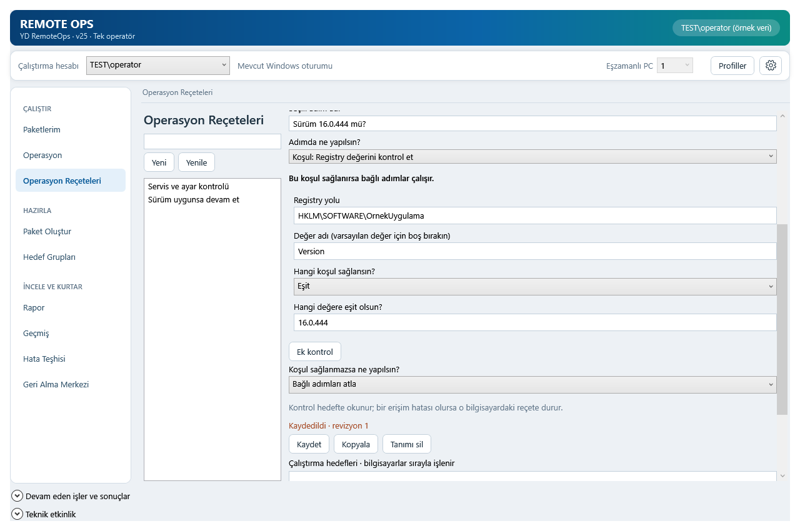

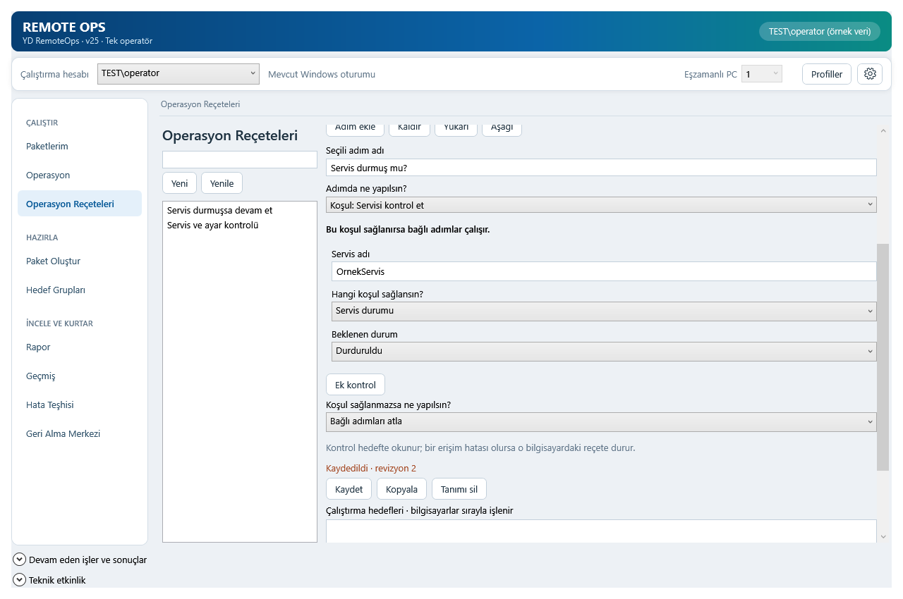

Mevcut koşulsuz ve v24 koşullu reçeteler açılır. Eski karşılaştırma değiştirilmeden kaydedilirse kayıtlı tür kısıtı korunur. Eski koşulda beklenen değer veya karşılaştırma değiştirilirse yeni otomatik karşılaştırma kullanılır. Yeni otomatik koşullar v25 gerektirir; eski uygulamalar bu yeni reçete biçimini açamaz. Önceki dağıtım ve kişisel veri yolları korunur.

Çok satırlı registry değerinde her öğeyi ayrı satıra yazın; JSON bilmek gerekmez. Satır sırası, boşluklar ve boş satırlar önemlidir. Boş metin tek boş öğedir, sıfır öğeli dizi değildir. CRLF/LF satırları böler; tek CR harfi verinin parçası kalır. Önceden kayıtlı açık tür karşılaştırmaları değiştirilmedikçe eski kuralları kullanır. Desteklenen hedef türleri mevcut beş registry türüdür; desteklenmeyen veya bozuk hedef verisi hata olarak raporlanır.

Bu teslimde gerçek uzak hedef değiştirilmedi. Ekranlar yalıtılmış örnek verilerle gerçek WPF çizimidir. Aşağıdaki eski sürümlerin tür seçtiren veya ayrı Koşul ekle düğmeli açıklamaları tarihsel bilgidir; v25 arayüzünü anlatmaz.

15 Ekim 2026 · YD_RemoteOps.App_v25

## v24 — Registry ve servis koşullu reçeteler

Mevcut koşulsuz reçeteler aynı sırayla ve aynı onaylarla çalışır. Koşul eklenen reçeteler yeni şemayla kaydedilir; v23 ve daha eski uygulamalar bu yeni reçeteleri açamaz. Mevcut kişisel reçeteler otomatik dönüştürülmez.

Operasyon Reçeteleri ekranında Koşul ekle düğmesini kullanın. Koşula ad verin, Tümü sağlansın veya Herhangi biri sağlansın seçin. Denetim ekle ile bir grupta 1–10 kontrol tanımlayın. Registry anahtarı/değeri için Var/Yok, registry değeri için Eşit/Eşit değil; servis için Var/Yok, Servis durumu veya Başlangıç türü seçilebilir. Servis adını tam yazın. Durum için Running/Stopped gibi sistem değerleri, başlangıç türü için Automatic/Manual/Disabled kullanılır.

Registry karşılaştırmaları türü dikkate alır. REG_SZ, REG_EXPAND_SZ, REG_DWORD, REG_QWORD ve REG_MULTI_SZ desteklenir. Sayılar ondalık veya 0x biçiminde; çoklu metin JSON dizisi olarak girilir. Metinler büyük/küçük harfe duyarlı karşılaştırılır. Değerin bulunmaması Eşit değil koşulunu sağlamaz; bunun için ayrı Yok kontrolünü seçin. Anahtar kontrolünde değer adı ve beklenen tür/değer boş kalır. Servis kontrolünde registry yolu ve beklenen registry türü boş kalır. HKCU mevcut registry modülleriyle aynı tek etkileşimli kullanıcı SID çözümlemesini kullanır; belirsiz kullanıcı hatadır.

Koşuldan sonra normal Adım ekle ile işlemleri oluşturun. İlgili işlemde Adımın koşulu listesinden önceki koşulu seçin. Bağlı adımlar koşulun hemen ardından kesintisiz sıralanmalıdır; girintili görünür. Koşulsuz seçilen adım koşul bloğunu bitirir. Sonraki yeni koşul yeni bir blok başlatır. İç içe koşul ve ileri adıma başvuru yoktur. Bağlı adımları olan koşul doğrudan silinmez; önce bağlantıları düzenleyin. Geçersiz yeniden sıralama geri çevrilir. Reçete kopyalandığında koşul bağlantıları yeni kimliklerle korunur.

Yanlış sonuçta Bağlı adımları atla seçilirse yalnızca o koşula bağlı işlemler atlanır; sonraki koşulsuz adımlar devam eder. Bu hedefin reçetesini durdur seçilirse o bilgisayarda kalan işlemler başlamaz; sonraki bilgisayara geçilir. Erişim reddi, hatalı/eksik sağlayıcı sonucu ve okunamayan durum koşulun yanlış olması değildir: o hedef durur. Herhangi biri seçili ve bir kontrol doğru olsa bile başka kontrolde hata varsa işlemler başlamaz.

Koşullar her hedefte kendi adımına gelindiğinde salt okunur sorgularla değerlendirilir. Önizleme koşulları sorgulamaz; tanımları, bağlı adımları ve hesabı gösterir. Kaydedip önizlemeyi açın; mevcut RECETE onayı geçerlidir. Çalışma raporu her kontrolde beklenen/okunan değer ve eşleşmeyi, koşul nedeniyle atlanan işlemleri ve hataları saklar. Alt süreç sonuçları onaylı kontrol tanımına bağlanır; eksik veya tutarsız kanıt bağlı değişikliği başlatamaz.

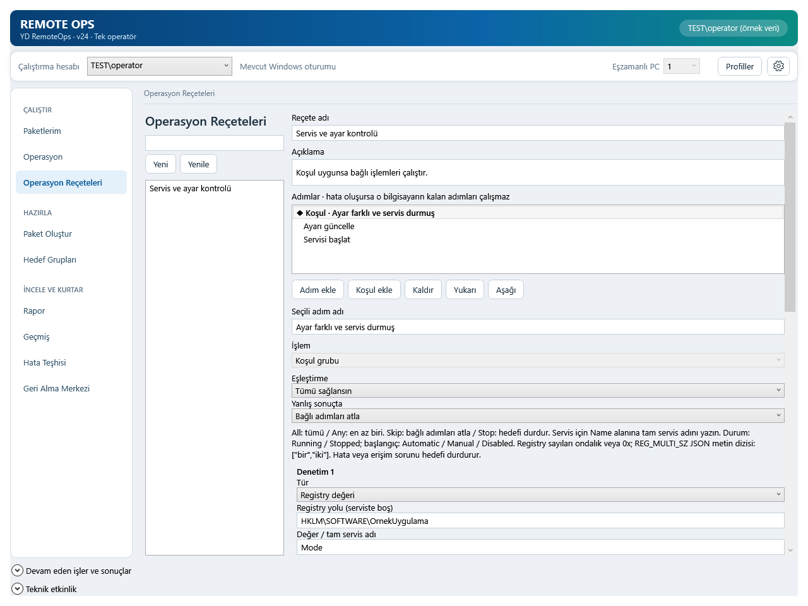

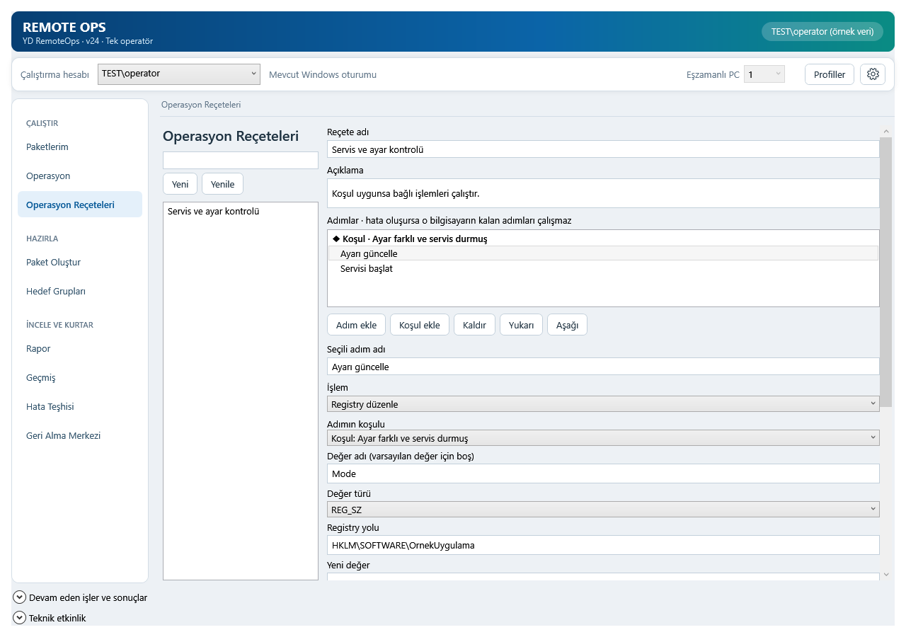

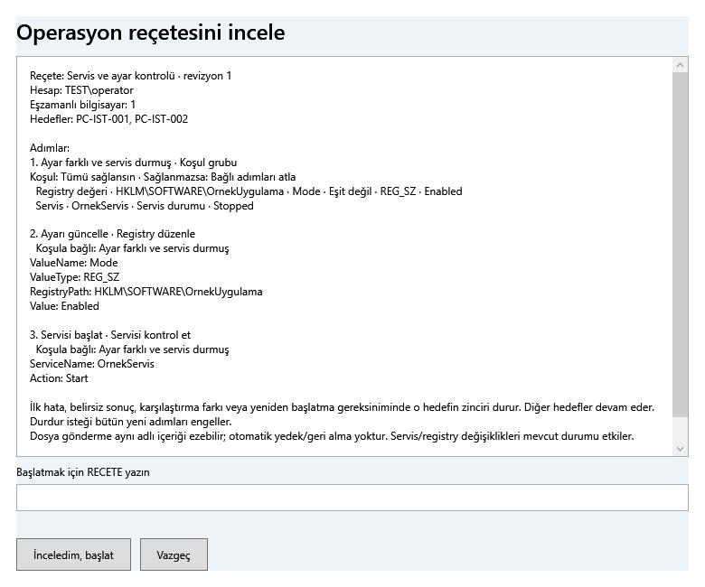

Örnek: Mode değeri mevcut ve Enabled değilse VE OrnekServis durmuşsa ayarı güncelle, servisi başlat. Mode yoksa gruptaki Eşit değil yanlış olur; eksik değeri de kapsamak isterseniz Yok için ayrı bir koşul grubu tasarlayın.

Sınırlar: toplam 20 adım sınırına koşul adımları da dahildir; grup başına 10 denetim. Koşul ile bağlı işlem arasında hedef durumu değişebilir; atomik işlem veya otomatik geri alma değildir. REG_EXPAND_SZ kayıpsız okumada mevcut Remote Registry yardımcısının erişim gereksinimleri geçerlidir. Bu teslim yerel sahte sınır ve WPF testleriyle doğrulanır; canlı şirket hedefi değiştirilmedi. Aşağıdaki eski sürüm açıklamaları tarihsel bilgidir; geçmişte koşul olmadığına ilişkin ifadeler v24 kapsamını anlatmaz.

15 Ekim 2026 · YD_RemoteOps.App_v25

## v23 — Ortak hedefler, sonuç filtreleri ve geçişler

Tek operatör için ikinci aşama. Paketlerim, Operasyon ve Operasyon Reçeteleri ekranlarında aynı hedef araçları bulunur. Seçili tekil hedef ve tekrar sayısı giriş sırasında güncellenir. Tekrarları temizle ilk yazılan adı koruyarak listeyi düzenler; geçersiz ad varsa girdi değişmez. Hedefleri düzenle penceresinde bilgisayar arayın, bir veya birden fazla hedefi seçip çıkarın ve Listeyi uygula ile kaydedin. Arama yalnızca görünümü süzer; aramada görünmeyen hedefler korunur. Vazgeç değişiklikleri uygulamaz. Açık pencere sırasında asıl hedef alanı değişirse eski liste uygulanmaz.

Hedefler üç ekran arasında otomatik eşitlenmez ve diske yeni bir ortak hedef listesi yazılmaz. Hedef gruplarına git kaydedilmiş kişisel listelerin ekranını açar; grubu hedef alanına aktarmak için dönüp Ekle/Değiştir seçilir. Her çalıştırmada mevcut önizleme ve onaylar geçerlidir.

Devam eden işler ve sonuçlar panelinde bilgisayar adı ve özgün sonuç kodu birlikte filtrelenebilir. Görünen / toplam hedef sayısı gösterilir; Filtreleri temizle bütün satırları geri getirir. Kaynak sonuç ve raporlar değişmez. İlerleme yenilenirken seçim çalışma ve bilgisayar kimliğiyle korunur; gizlenen satırın eski eylemleri açık kalmaz. Geçmiş ekranında hedef tablosu için ayrıca bilgisayar/sonuç filtresi vardır. Çalışma filtresi ile hedef filtresi ayrı kapsamları süzer.

Seçili sonucu teşhis et, ilgili çalışmanın rapor kökü ve hedefi eşleşiyorsa doğru teşhisi açar. Rapor henüz oluşmadıysa açıklama gösterilir. İzleme, Geçmiş ve Hata Teşhisi ekranlarından seçili bilgisayarın yedeklerine geçilebilir. Bu geçiş Geri Alma Merkezi filtrelerini ilgili bilgisayara ayarlar, önceki tür/tarih filtrelerini temizler ve bir geri alma kaydını otomatik seçmez. Hedefe bağlanmaz; geri alma başlatmaz.

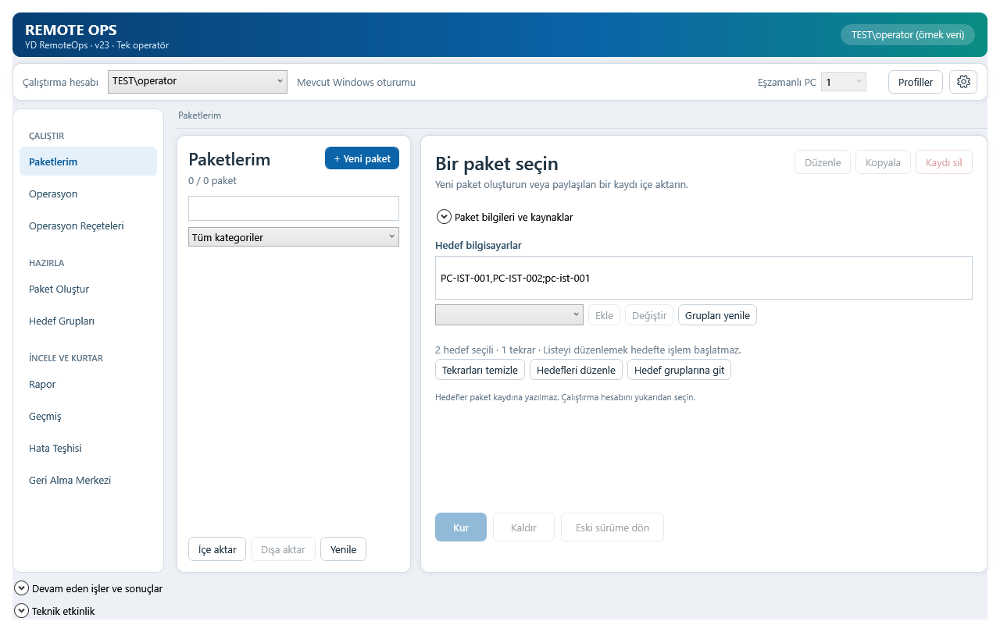

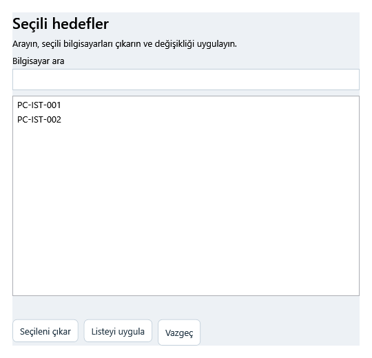

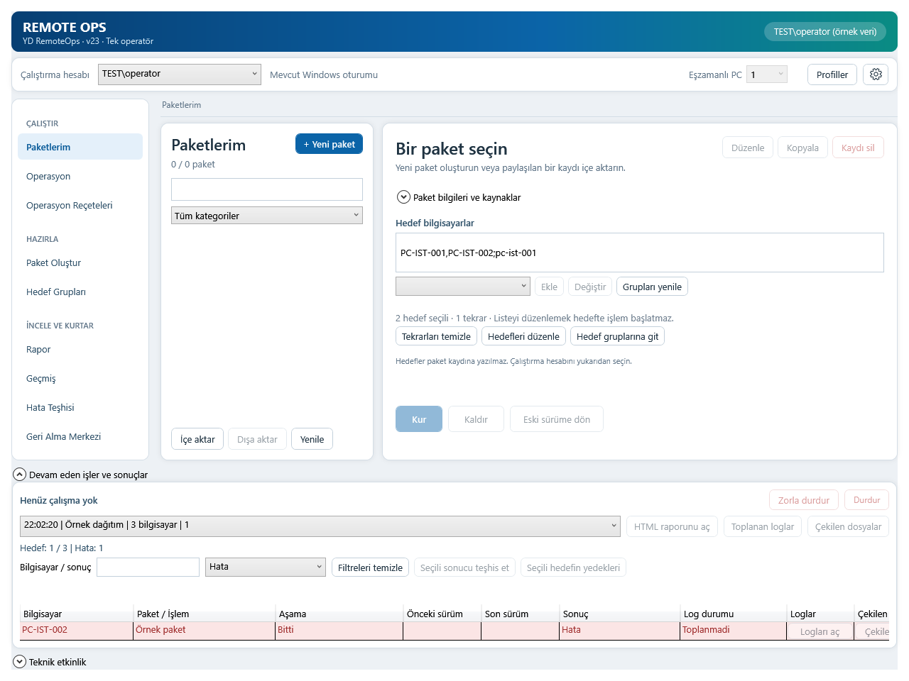

Bu teslimde uzak motor, çalışma hesapları, C:\Temp\YD_RemoteOps.App ve AppData yolları korunur. Gerçek uzak hedef testi yapılmadı. Ekranlar örnek verilerle gerçek WPF çizimidir. Aşağıdaki eski sürüm bölümleri ve ekranlar tarihsel bilgi olarak korunur.

15 Ekim 2026 · YD_RemoteOps.App_v25

## v22 — Tek operatör için yeni ekran düzeni

Uygulama tek operatör tarafından kullanılır. Farklı çalışma profilleri aynı operatörün uzak hedeflerde kullandığı hesaplardır. Ekip kataloğu, çok kullanıcılı onay veya operatörler arası merkezi kilit bu teslimin kapsamı değildir.

Üst sekmeler yerini üç gruplu sol menüye bırakır: Çalıştır (Paketlerim, Operasyon, Operasyon Reçeteleri), Hazırla (Paket Oluştur, Hedef Grupları), İncele ve Kurtar (Rapor, Geçmiş, Hata Teşhisi, Geri Alma Merkezi). Dokuz mevcut ekran ve Yeni paket / Düzenle gibi geçişler korunur. Dar pencerede menü kaydırılabilir. Uygulama başlığında kökteki VERSION.json sürümü görünür.

Teşhiste sonuç nedeni ve sonraki adım ayrı kartlardır. Özgün kayıtlar Teknik ayrıntılar ve özgün kayıtlar bölümünde açılır. Geri almada yerel yedek, son yerel sonuç ve hedefin güncel durumu ayrı kartlardır. Güncel durum otomatik sorgulanmaz; geçmişteki başarı hedefte şu an doğrulama yapıldığı anlamına gelmez. Kapsam ve teknik ayrıntılar açılır bölümde kalır. Filtrelerde kalıcı alan etiketleri vardır; liste ve ayrıntı genişlikleri ayarlanabilir.

Çalıştırma hesabı ve paralellik üstte, devam eden işler ile teknik etkinlik altta kalır. Yürütme motoru, onaylar, uzak işlem davranışları, C:\Temp\YD_RemoteOps.App ve AppData katalog/profil yolları değiştirilmedi. Bu teslim için uzak hedeflerde canlı test yapılmaz; ekranlar yalıtılmış örnek verilerle çizilir. Aşağıdaki önceki sürüm bölümleri tarihsel bilgi ve özellik açıklamasıdır; eski üst sekmeli görseller v22 gezinmesini göstermez.

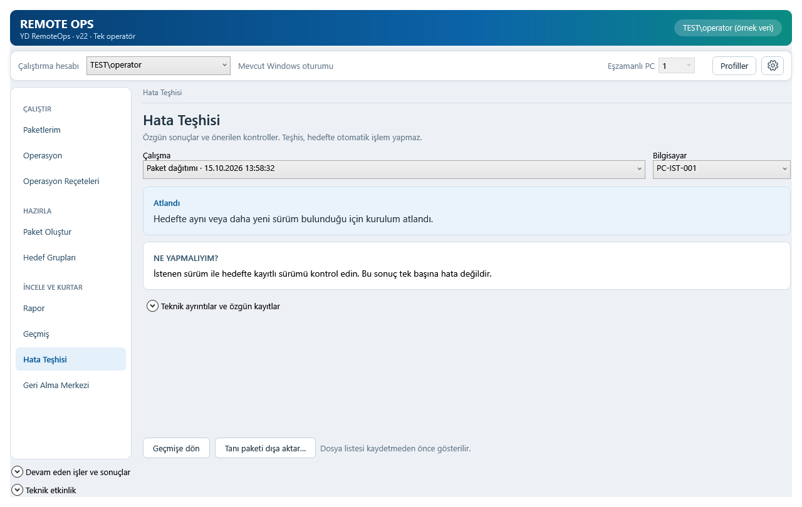

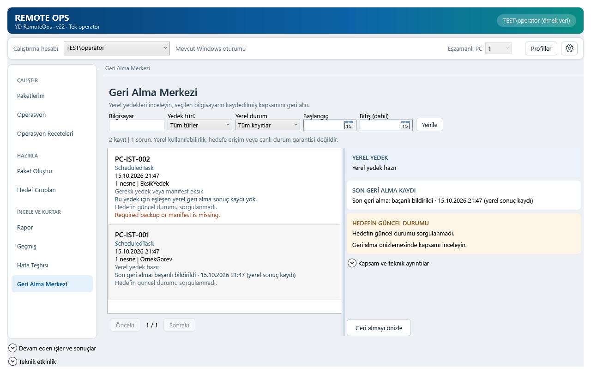

## v18 güncel teslim

Operasyon reçeteleri dokuzuncu sekme olarak eklendi. Başlangıç67/67 test dosyası geçti; beş yeni dosyayla kapsam72 dosyadır. Güncel test/parse sayıları V18_TEST_RESULTS.csv, V18_PARSE_RESULTS.csv ve V18_VALIDATION.json içinde hesaplanır. Son teslim kapısı bütün testlerin ve ZIP hash/CRC kontrollerinin geçmesini gerektirir.

Gerçek koordinatör, üst Runner ve dört child süreç kontrollü yerel fixture'da çalıştırıldı; bütün CIM/SMB/PsExec sınırları sahtedir. WPF editör/önizleme, revizyon ve snapshot, sonuç eşleme, iptal, kesinti, yeniden açılış ve tek geçmiş kaydı doğrulandı. Canlı şirket hedefinde işlem yapılmadı. Bağımsız incelemede timeout child takibi, kesilen aktif adım kimliği ve açılış rapor onarımı düzeltildi. %125 görünümde bütün editör kaydırılabilir hale getirildi.

## Tarihsel v17 teslimi

Birleşik Geri Alma Merkezi eklendi. Başlangıç 64 test dosyası; üç yeni test dosyasıyla kapsam 67 dosya oldu. Güncel sonuçlar V17_TEST_RESULTS.csv, V17_PARSE_RESULTS.csv, V17_VALIDATION.json ve V17_INCELEME.md içindedir. 98 PowerShell dosyasında sözdizimi denetimi yapıldı. Son teslim kapısı bütün testlerin başarılı olmasını ve ZIP içeriğinin SHA-256/CRC ile doğrulanmasını gerektirir. Beş geri alma türü fixture/mock sınırlarıyla ve arayüz gerçek yerel WPF kontrolleriyle doğrulanır. v17 için gerçek şirket hedefinde canlı bağlantı veya değişiklik yapılmadı.

Bağımsız incelemede dosya sonuçlarının iç içe dizi olması, eksik registry eski değerinin boş metne dönüşmesi ve servis/görev son kapsam kontrolünün atlanması saptandı; regresyonlarla düzeltildi. Türkçe kültürde I içeren bilgisayar adının yanlış reddi de düzeltildi. Önceki sürüm bölümleri tarihsel kanıttır.

## Tarihsel v16 teslimi

Kayıtlı hedef grupları ve yerel işlem önizlemesi eklendi. Başlangıç 60 test dosyası, dört yeni dosyayla son tur 64 test dosyasıdır. Güncel sonuç ve kapsam V16_TEST_RESULTS.csv, V16_VALIDATION.json ve V16_INCELEME.md içindedir. Üç bağımsız inceleme bulgusu regresyonlarla düzeltildi. Şirket hedefinde canlı bağlantı/mutasyon yapılmadı. Önceki bölümler kendi sürümlerinin tarihsel kanıtıdır.

Tarihsel v15 teslimi: [v15 inceleme özeti](V15_INCELEME.md), [güncel testler](V15_TEST_RESULTS.csv) ve [doğrulama manifesti](V15_VALIDATION.json). Aşağıdaki v14 ve önceki bölümler tarihsel kanıttır. Bu teslimde gerçek şirket hedeflerinde canlı işlem yapılmadı.

## v15 yerel doğrulama

Başlangıç 57/57 test dosyası geçti. Üç yeni testle tam regresyon 60 dosyayı kapsar; sonuç ve kapsam V15_TEST_RESULTS.csv, V15_VALIDATION.json ve V15_INCELEME.md içindedir. Gerçek WPF ekranları örnek verilerle doğrulandı; gerçek şirket hedeflerinde işlem yapılmadı. İki bağımsız inceleme bulgusu (çalışma kimliği izolasyonu ve tanı dosyası izin listesi) regresyonlarla düzeltildi. Geçmiş ve teşhis görüntüleri screenshots-v15 altındadır.

## Tarihsel v14 ve önceki denetimler

15 Ekim 2026 · YD_RemoteOps.App_v14 · Yerel güvenilirlik denetimi

Bu denetim mevcut uygulama, altı modül, paket kataloğu, dağıtım motoru, rapor ve WPF akışlarını kapsar. Gerçek şirket uç noktalarına bağlanılmadı. Otomatik regresyonlarda izole fixture/mock verileri kullanıldı; ayrıca bu bilgisayarda gerçek CIM/DCOM, SMB, dosya, registry, servis, görev ve süreç çağrılarıyla 18 güvenli canlı senaryo doğrulandı. Paket kurulumları ve şirket ağı kabul testi bu yerel canlı turun kapsamında değildir. Gerçek Windows PowerShell 5.1 süreçleri, WPF kontrolleri ve yerel dosya kilitleri kullanıldı. Bu sonuç sıfır hata garantisi veya şirket ağı kabulü değildir.

## 1. Sonuç ve kanıt

Son doğrulama: 50 bağımsız test dosyası geçti; 66 PowerShell dosyasında parse hatası yok. Sayılar test dosyasıdır; tekil assertion veya test edilen gerçek hedef sayısı değildir. İlk 34 dosyalı başlangıç turu da geçti; buna rağmen bağımsız inceleme ve yeni hata senaryoları aşağıdaki sorunları ortaya çıkardı.

Tam test çıktısı [KAPSAMLI_TEST_SONUCLARI.csv](KAPSAMLI_TEST_SONUCLARI.csv), güncel doğrulama/dağıtım hash kaydı [DOKUMAN_DOGRULAMA.json](DOKUMAN_DOGRULAMA.json) içindedir. Düzeltmelerden önce ilgili yeni testlerin hata verdiği, düzeltmelerden sonra geçtiği doğrulandı.

## 2. Bulunan ve düzeltilen sorunlar

| Alan | Önceki hata | Düzeltme ve doğrulama |
| --- | --- | --- |
| Registry geri alma | Değişiklik önce yapılıyor, manifest sonra yazılıyordu. Disk hatasında eski değer kaybolabilirdi. | Eski değer atomik manifest olarak değişiklikten önce saklanır. Yazılamazsa uzak Set/Delete çağrılmaz. Edit ve Delete test edildi. |
| Registry okuma hatası | Dönüş kodu 1, değer yokmuş gibi kabul edilerek yazma/silme yapılabiliyordu. | Yalnızca 2 kesin bulunamadı sayılır; 1 ve erişim reddi 5 için değişiklik engellenir, okuma Failed raporlanır. Üç akış da test edildi. |
| Servis geri alma | Servis durum/başlangıç türü manifesti operasyon sonuna kalıyordu. | Eski durum önce atomik kaydedilir; disk hatasında servis değiştirilmez. Stop ve Startup test edildi. |
| Paket JSON türleri | Dizi/nesne olarak gelen ad/açıklama gibi alanlar doğrulamadan geçip aramada hata oluşturabiliyordu. | Metin alanlarında JSON string tipi zorunlu. Hatalı import hedef kataloğa yazmadan reddedilir. |
| Kategori filtresi | Son paket başka kategoriye taşınınca ekranda Tüm kategoriler seçiliyken liste boş kalabiliyordu. | Filtre yenilenen seçime göre hesaplanır; gerçek WPF düzenle/kaydet akışı test edildi. |
| Profil kimliği | Main silinince başka bir kayıt sessizce Main yapılıyor ve kayıtlı hesap yerine mevcut token ile çalışabiliyordu. | Diğer kayıtların credential/Main anlamı korunur; otomatik terfi kaldırıldı. |
| Rapor zamanı | ISO string CompletedAt, işlem bitişi yerine rapor yazılma zamanı olarak kaydediliyordu. | Serileştirilmiş bitiş zamanı korunur; geçmiş gün/saat testi eklendi. |
| Kesilen dağıtım | Beklenmedik Runner çıkışı hedefleri hâlâ çalışıyor/bekliyor gösterebiliyordu. | Bilinen sonuçlar korunur; doğrulanmamış hedef belirsiz, sonucu hiç oluşmamış hedef hata olur. Kısmi rapor kurtarılır. |
| Son ilerleme özeti | Hedef durumları güncellenmeden eski başarı/hata sayısı yazılıyordu. | Özet hesaplandıktan sonra ilerleme metnine eklenir; son tick testi eklendi. |
| Eski checkpoint | Aynı bilgisayar için başka çalışmanın başarısı yeni sonuca taşınabiliyordu. | Çalışma ve paket kimliğiyle kapsam daraltılır. D4 hedef kimliğinin 10.000 ve üzerindeki indeksleri de desteklenir. |
| ProductID eşleşmesi | İlk kayıt bulununca tarama kesiliyor, diğer eşleşmeler ve tam anahtar seçimi görünmüyordu. | Bütün eşleşmeler toplanır; birden fazla kayıt belirsiz sayılır, tam anahtar filtresi tüm adayları görür. |

## 3. Test kapsamı

Registry dönüş kodları [Microsoft sistem hata kodları](https://learn.microsoft.com/en-us/windows/win32/debug/system-error-codes--0-499-) ve [StdRegProv GetStringValue](https://learn.microsoft.com/en-us/previous-versions/windows/desktop/regprov/getstringvalue-method-in-class-stdregprov) belgeleriyle kontrol edildi.

| Grup | Sınanan davranış |
| --- | --- |
| Paket kataloğu | Şema, Unicode, revizyon, silme, kopyalama, import/export, özel alanların dışlanması ve bozuk veri. |
| Eşzamanlı kayıt | Aynı revizyona sekiz gerçek PowerShell yazıcısı: bir kayıt başarılı, yedi çakışma; JSON/revizyon sağlam ve geçici dosya sızıntısı yok. |
| Dağıtım | Install/Uninstall/Downgrade, bağımsız kimlikler, tam/alt sınır sürüm politikaları, kaynak erişimi ve sahte worker çıkış kodları. |
| Kesinti | İptal, force stop, checkpoint, kısmi rapor, eski çalışma izolasyonu ve beklenmedik worker başlangıç hataları. |
| Paralellik | Tek hedefli worker süreçleri, sıralı geri dönüş, hata izolasyonu ve canlı hedef snapshot'ları. |
| WPF | Başlangıç, paket kaydı/aktarımı, ad/kategori kalıcılığı, kısa ekran, ortak hedef tablosu ve sütun okunabilirliği. |
| Rapor | Hedef başına tek özet, adım ayrıntıları, exit/log alanları, HTML escaping, karma başarısız hedefler, günlük kırılımlar ve zamanlar. |
| Dosya/registry/servis/görev | Onaylar, kapsam ve geri alma kayıtları; hash/yedek kontrolleri, korunan hedefler ve hatalı yöntem dönüşleri. |
| Log toplama/temizleme | Başarı/timeout/hata kapıları, kullanıcı adı sınırları, değişen/kilitli/korunan dosyalar ve sayısal sınır. |
| Başlatıcı/hesap | Windows PowerShell 5.1, gizli süreçler, Main/credential sınırı, preflight yolları ve parola aktarım biçimi. |

## 4. Şirket ortamında kalan doğrulama

Yerel fixture testleri şu koşulları kanıtlamaz: domain hesabının gerçek hedef yetkisi, SMB/DCOM erişimi, EDR/PsExec davranışı, SYSTEM hesabının UNC ve script bağımlılıklarını okuması, gerçek yükleyici exit code/registry kaydı ve reboot sonrası uygulama durumu. Şirket testinde önce tek hedef ve paralellik 1 ile [pilot tablosu](PAKET_YONETIMI_PILOT_KONTROLU.md) doldurulmalıdır.

Fotoğraftaki 50010 kodunun kaynağı henüz belirlenmedi. İlgili Results.csv, RemoteOps.log ve paket/PsExec çıktısı olmadan neden atanmamıştır. Kod başarıya çevrilmedi ve yeni düzeltmeler bu hatanın gerçek paket nedenini çözmüş sayılmaz.

## 5. Dağıtım ve sınırlar

Bu turda hem RemoteOps.App hem Modules altında kaynak değişti. Şirket kopyasını güncellerken iki klasör birlikte taşınmalıdır. Kaydedilmiş profiller/paketler APPDATA altında, çalışma verileri C:\Temp\YD_RemoteOps.App altındadır; bunlar dağıtım klasöründen ayrıdır.

FullLanguage Windows PowerShell 5.1 çalışma varsayımıdır. Kilitler ayrı operatör bilgisayarları arasında merkezi koordinasyon sağlamaz. Otomatik reboot, retry, eski paketi geri kurma veya tam GUI çökmesi sonrası otomatik resume yoktur. Geri alma dosyaları ve yedekler birlikte tutulur; DeleteBackups saklama süresi uzun vadeli arşiv değildir.

## 6. İnceleme ve dokümanlar

İki bağımsız inceleme paket/arayüz ve dağıtım/kurtarma akışlarını kontrol etti. Bulgular yerel testlerle yeniden üretildi; düzeltmeler ve incelemede bulunan sınır durumları yeniden doğrulandı. Kılavuz ve teknik el kitabı bu sonuçlarla eşitlendi. Güncel ekran görüntüleri örnek verilerdir.

## 7. Çalıştırma görünümü güncellemesi

Son çalıştırma varsayılan görünümü, önceki çalıştırmaya dönüş, arka plan güncellemelerinde seçim korunması, aynı bilgisayarın ayrı gruplarda gösterimi ve seçili rapor izolasyonu eklendi. RemoteOps.RunSelection.Tests.ps1 bu davranışları sınar; tam pencere başlangıç testi gerçek ComboBox SelectionChanged olayını ve gruplamayı doğrular. Seçim olayında SelectedItem kullanılır. Rapor klasörü bağlantısı yazılmadan önce Runner yol kapsamı doğrulanır.

## 8. Erişilemeyen hedefler ve log kısayolları

Kayıtlı paketlerde gerçek WMI/DCOM ön kontrolü eklendi; erişilemeyen ve yetki reddi olan hedeflerde paket çalıştırılmaması, diğer hedeflerin devam etmesi Runner entegrasyon testinde doğrulandı. Genel kimlik mesajı yerine orijinal tespit hatası da korunur. TargetAccess ve DetectionErrors testleri üç paket eylemini kapsar. LogNavigation testi aynı istemcinin iki farklı çalıştırmadaki dosyalarını ayırır ve yanlış/eksik klasörleri kapatır. Gerçek WPF başlangıç testi üst ve istemci log düğmelerinin doğru yolu açmasını sınar. Gerçek şirket ağı erişimi ve log izinleri yine pilotta doğrulanmalıdır.

## 9. Ayrı eski sürüm paketi

Normal Install ve eski sürüm Downgrade tanımları bağımsız hale getirildi. Normal 5.0/eski 2.0 kaynak/kimlik/sürüm ayrımı motor ve gerçek izole Runner entegrasyonunda doğrulandı. UI üçüncü kart, kaydetme, kopyalama, doğru kaynak/sürüm içeren onay özeti test edildi. /1 anlam koruyan geçiş, okurken dosyaya dokunmama, kaydederken /2 revizyonu ve /1 import testleri eklendi. /2 schema ve export sürümü eski okuyucuda sessiz yanlış eylemi önler. Şirket kopyasında RemoteOps.App içindeki dosyalar birlikte güncellenmelidir.

## 10. v10 örnekler, çekilen dosyalar ve canlı test

Klasör v10 olarak yeniden adlandırıldı. Dosya/registry/task/service/process girişlerine açıklayıcı örnekler ve çalışma/istemciye bağlı çekilen dosya kısayolları eklendi. Gerçek WPF buton yönlendirmeleri ve örneklerin boş girişleri doldurmaması test edildi. Türkçe kültür ASCII I doğrulaması ile DCOM görev silme Confirm uyumsuzluğu canlı turda bulundu, regresyon testleriyle düzeltildi.

Mevcut bilgisayarda yönetici token ile 18/18 gerçek canlı senaryo geçti: SMB/DCOM erişimi; dosya pull/push/compare/yedekle-sil-restore/browse/move-replace rollback; registry read/edit/delete/rollback; servis list/start/restart/stop/startup rollback; görev list/disable/enable/run/delete/XML rollback; sahip olunan süreç query/kill. Altı cleanup kontrolü true, CleanupErrors boş. [Canlı test raporu](CANLI_TEST_RAPORU.md), [ham sonuç](live-test/LOCAL_LIVE_TEST.json), [CSV](live-test/LOCAL_LIVE_TEST.csv) bulunur. Bu yerel doğrulama şirket domain kabulünden ayrıdır; gerçek paket kurulumu yapılmadı.

## 11. v11 ortak erişim ve sonuç sınıflandırması

Bütün yerleşik operasyonlar aynı hedef ön kontrolünü kullanır. SMB ve WMI bağımlılıkları operasyonun gerçek ihtiyacına göre seçilir; kontrolsüz script WMI gerektirmez. Erişilemeyenler sarı/neutral grubundadır, gerçek hatalar kırmızı kalır. Ham Unreachable geçmişi korunur. Bağımsız incelemede atlanan paket metadata kaybı, eksik ağ hata kodları, SMB zaman sınırı ve geçersiz operasyonun erişilemedi diye sınıflandırılması yakalandı; düzeltmeler testlerle doğrulandı.

Yeni BatchAccess, OperationAccess, UnreachableClassification, BoundedProbe ve UncheckedScript testleri eklendi; gerçek WPF satır rengi de sınanır. v11'de mevcut bilgisayarda 26/26 salt okunur operasyon erişim kontrolü geçti; hedefte gerçek operasyon/mutasyon çağrılmadı. Ayrıntı live-test-v11/ACCESS_LIVE_TEST.json içindedir. v10'daki 18/18 mutasyon ve geri alma sonucu tarihsel kanıt olarak korunur.

## v12: Yedek seçim alanının doğrulanması

Yeni BackupSelection testi yapay manifestlerle birden çok bilgisayar/dosya bilgisini, eksik yedeklerin listelenmemesini, gerçek WPF kontrolünü, gönderilen sabit kimliği, boş listenin devre dışı olmasını ve kayıp seçimin reddedilmesini sınar. Ekran görüntüsü yapay örneklerden üretilmiştir. Bu teslimde gerçek hedefe geri yükleme yapılmamıştır. Önceki canlı test kayıtları kendi sürümlerinin tarihsel kanıtıdır.

## v13: Registry kökleri ve rollback seçimleri

RegistryPaths testi kısa/uzun kökleri, geçersiz yolları, tekil HKCU SID çözümünü, belirsiz/kullanıcısız oturum reddini ve eski HKLM manifestlerini doğrular. RegistryHiveRoundTrip mock hedeflerde 15 read/edit/delete senaryosu ile runner rollback'in doğru hive ve kaydedilen SID'ye döndüğünü sınar. RollbackChoices gerçek WPF kontrolünde registry/servis listelerini, tam manifest gönderimini, boş seçim reddini ve eski/yeni değer yönünü doğrular. Ekran görüntüleri yapay veridir. Güncel test dökümü REGISTRY_ROLLBACK_VALIDATION_v13.txt ve CSV içindedir. Bu teslimde gerçek hedefte registry/servis değişikliği yapılmamıştır; önceki sürümlerin canlı testleri tarihsel kanıttır.

## v14: Registry tür desteği doğrulaması

RegistryTypes testi beş türü, DWORD/QWORD sınırlarını, hex dönüşümünü, geçersiz verileri, tam UINT64 hassasiyetini ve dizi tipli CIM argümanlarını doğrular. RegistryTypedRollback mock hedeflerde edit/delete, kalıcı CSV, runner/konsol geri alma, yeni QWORD oluşturma/silme, tür uyuşmazlığı, geçersiz veri ve ham okuma başarısızlığının değişikliği engellemesini sınar. Gerçek runner dispatch bloğu GUI tür seçimiyle çalıştırılır. RegistryTypedUi gerçek WPF tür seçiciyi, çok satırlı girişi, boş metni ve tür bilgili özetleri doğrular. Görseller örnek verilerle üretilir.

Mevcut yerel HKLM Environment/ComSpec REG_EXPAND_SZ değerinde yalnızca salt okunur bir kontrol yapıldı; ham %...% ifadesi korundu. Gerçek hedefte registry değişikliği/rollback yapılmadı, uzak Remote Registry erişimi canlı olarak sınanmadı. Tam test kayıtları REGISTRY_TYPES_VALIDATION_v14.txt ve CSV içindedir. Önceki sürümlerin canlı test kayıtları tarihsel kanıttır.

## v17 — Birleşik Geri Alma Merkezi

Geri Alma Merkezi sekmesi, DeleteBackups, FileRollbacks, RegistryRollback ve ServiceTaskRollbacks altındaki yerel manifestleri birlikte gösterir. Dosya/klasör geri yükleme, dosya taşıma/değiştirme geri alma, registry, servis ve zamanlanmış görev kayıtları desteklenir. Bir kayıt tek manifest, tek bilgisayar ve tek türdür; aynı kaydın bütün nesneleri kapsam içindedir. Farklı çalışmalar birleştirilmez. Süreç sonlandırma ve görev çalıştırma geri alınabilir gösterilmez.

Bilgisayar, tür, kullanılabilirlik ve tarih aralığıyla filtreleyin; sayfa başına 50 kayıt görünür. Bitiş tarihi günün tamamını kapsar. İlk sekme açılışı ve Yenile yerel dosyaları okur; arka planda sürekli tarama veya hedef sorgusu yapılmaz. Yerel yedeğin bulunması, hedefe erişim veya güncel durum garantisi değildir. Eksik/bozuk yedekler açıklamalarıyla görünür ve başlatılamaz.

Kaydı seçip Geri almayı önizle düğmesini kullanın. Gerçek çalıştırma hesabı, bilgisayar, bütün nesneler ve kaydedilen eski durum gösterilir. Dosya geri yüklemede RESTORE, diğer türlerde ROLLBACK sözcüğünü yazarak İnceledim, başlat düğmesine basın. Vazgeç işlemi başlatmaz. Önizleme sonrası hesap, ilgili ayarlar, manifest, kayıt kapsamı veya gerekli yedeğin kontrol edilen kimliği değişirse yeniden önizleme gerekir. Runner hedefte değişiklikten önce seçimi tekrar doğrular; liste sıra numarası kullanılmaz.

Dosyalar geri kopyalanırken aynı adlı hedeflerin üzerine yazılabilir. Klasör geri yükleme hedefteki fazladan dosyaları silmez. Dosya taşıma geri almada kaynak, manifestte kaydedilen taşınmış konumdur. Registry türü ve kaydedilmiş HKU SID yolu korunur; eksik değer ile açıkça kaydedilmiş boş metin ayrılır. Servislerde kaydedilen eski durum/başlangıç türü uygulanır. Silinen görev XML yedeğinden oluşturulur, aynı adlı mevcut görev ezilmez. DTD ve dış kaynak çözümleme kapalıdır.

Bu sürüm tümünü geri al, otomatik zincir, otomatik tekrar deneme veya nesne bazında kapsam daraltma içermez. Mevcut Operasyon sekmesindeki geri alma girişleri korunur. Çalıştırma çıktıları mevcut rapor ve Geçmiş akışına gider. Uzun ömürlü dosya yedeklerinin bütün içerikleri indekslemede hash'lenmez; manifest SHA-256 ve yedek meta verisi, görev XML hash'i, yol ve reparse kontrolleri uygulanır. Bu, dosya yedeğinin tamamına kriptografik bütünlük veya işlem atomikliği garantisi vermez.

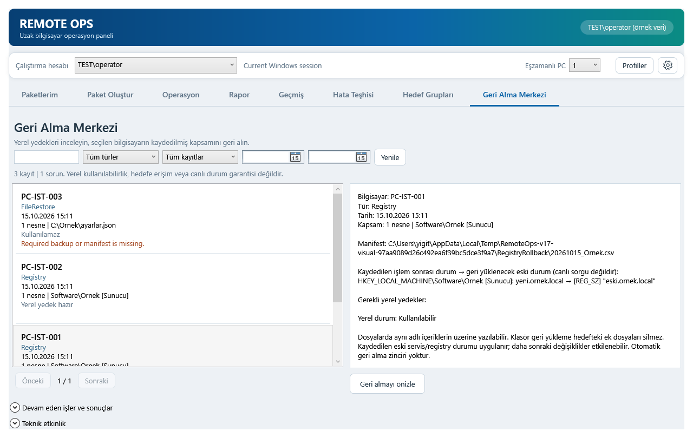

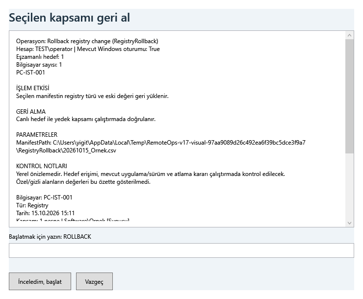

Görseller yerel fixture verileridir. v17 kapsamında gerçek şirket bilgisayarında uzak geri alma testi yapılmamıştır. Sürüm ayrı klasörde ve doğrulanmış ZIP ile teslim edilir; bu aşamada Drive yüklemesi yapılmaz.

## v18 — Operasyon reçeteleri

Dokuzuncu sekme Operasyon Reçeteleri, servis/dosya/registry/paket adımlarını sıralı bir kişisel tarifte birleştirir. Yeni ile ad/açıklama girin; Adım ekle ile 1–20 işlem oluşturun. Adımı seçip alanlarını düzenleyin, Yukarı/Aşağı ile sıralayın ve Kaydet kullanın. Sağ panel bütünüyle kaydırılır; küçük ekranda alt bölümdeki kaydetme ve çalıştırma alanlarına kaydırarak erişilir. Kopyala yeni kimlikli taslak hazırlar; Tanımı sil yalnız kişisel tarifi kaldırır.

İlk izin listesi: servis listeleme/kontrol/başlangıç türü; dosya gönderme/karşılaştırma/yedekli silme; registry okuma/düzenleme/silme ve kayıtlı paket dağıtımı. Serbest kod, eklenti, iç içe tarif, koşullu dal ve adımlar arası çıktı değişkeni yoktur. Reçeteler %APPDATA%/MDRemoteOps/Recipes altında şema/revizyonla tutulur. Hesap, hedefler, parola ve çalıştırma onayı tanımda saklanmaz.

Kayıtlı paketin tam tanımı reçeteye kopyalanır. Paket kataloğu sonradan değişirse eski reçete sessizce değişmez; güncellemek için adımda paketi yeniden seçip reçeteyi kaydedin. Hedefleri çalışma alanında yazın veya hedef grubunu Ekle/Değiştir ile kullanın. Reçeteyi önizle hesabı, hedefleri, sıralı bütün parametreleri ve etkileri gösterir. Her yeni çalıştırmada RECETE yazılır. Kaydedilmemiş düzenleme, değişmiş kayıt/hesap/hedef/ayar eski önizlemeyi geçersiz kılar.

Bilgisayarlar sırayla, her bilgisayarın adımları sırayla çalışır. Normal bir adım hatasında o bilgisayarın kalan adımları NotRun olur; sonraki bilgisayara geçilir. Dosya karşılaştırmada Farkli veya Bulunamadi zinciri durdurur. Dosya gönderirken atlanan dosyalar tamamlanmış sayılmaz. Servis listesinde eşleşme olmaması veya registry okumada değerin yokluğu bilgi olarak korunabilir; yazma hatasıyla karıştırılmaz. Paketin doğrulanmış zaten mevcut/yok/hedefte atlaması devam edebilir; genel Skipped devam izni değildir. Yeniden başlatma gereksinimi zinciri durdurur.

Durdur isteği bütün yeni adım/hedefleri engeller; aktif alt adımın sonucu beklenir. Zorla durdurmak yerel süreç ağacını sonlandırır; uzak işlemin durduğunu garanti etmez. Sonucu bilinmeyen aktif adım Indeterminate olarak, özgün adım ve bilgisayar kimliğiyle kaydedilir. Otomatik retry/resume/reboot/rollback yapılmaz.

Bir alt adım 7200 saniyelik bekleme eşiğini aşarsa yeni işler engellenir ve aktif yerel süreç takip edilmeye devam edilir. Süreç kendiliğinden bitene veya kullanıcı açıkça zorla durdurana kadar çalışma görünür kalır; başka hedefe gizlice geçilmez. Geçerli geç sonuç özgün satırlarda korunur; eşiği aşan reçete otomatik devam etmez. Bu eşik uzak işlemi otomatik öldüren bir süre sınırı değildir.

Uygulama yeniden açıldığında yalnız kesilmiş reçete checkpoint'leri yerel rapora dönüştürülür. PID ve süreç başlangıç zamanı hâlâ eşleşen Runner'a dokunulmaz. Başlamış fakat tamamlandığı kanıtlanamayan adım belirsizdir; başlamamış adımlar NotRun olur. Bu işlem hedefte reçeteyi sürdürmez ve ayrı yarım kalan işler merkezi eklemez.

Geçmişte reçete tek üst çalışma olarak görünür. Paket / reçete sütunu tarif adını gösterir; hedef başına tek terminal sonuç ve ayrıntıda özgün adım kimlikleri/çıktıları vardır. Alt süreçler günlük ledger'a ayrı çalışmalar eklemez. Teşhis özgün hata/exit code bilgisini korur. Servis/registry/yedekli silme manifestleri mevcut Geri Alma Merkezi'nde bulunabilir; tüm reçeteyi tek eylemle geri alma yoktur.

Dosya gönderme aynı adlı içeriği ezebilir ve otomatik yedek/geri alma sağlamaz. Örneğin servis durdurulduktan sonraki dosya adımı hata verirse sonraki servisi başlat adımı çalışmaz; önceki değişiklikler otomatik geri alınmaz. Yerel önizleme canlı hedef durumunu veya kaynak erişimini garanti etmez. Üst ve alt istekler 22000 Base64 karakter sınırına tabidir; çok büyük tarif açık hatayla reddedilir, kesilerek çalıştırılmaz.

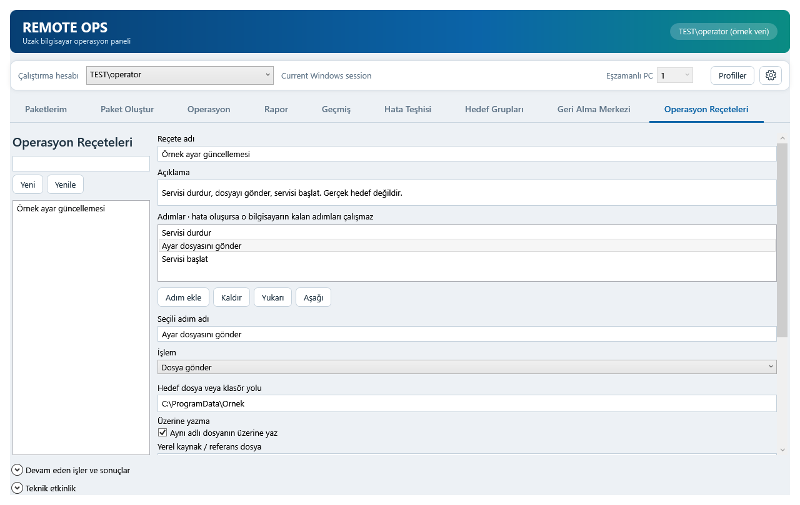

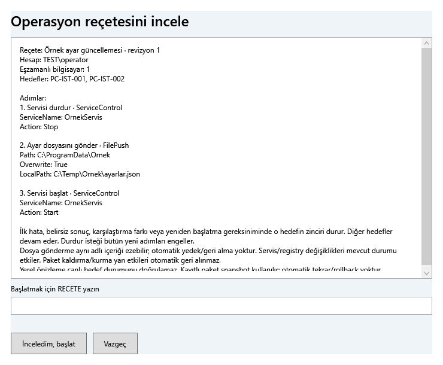

Doğrulamalar yerel fixture, sahte uzak çağrılar ve gerçek WPF/Runner süreçleriyle yapıldı. v18 için gerçek şirket hedefinde canlı işlem yapılmadı. Dağıtım v18 klasörü ve doğrulanmış ZIP'tir; v17 korunur, Drive yüklemesi yapılmaz.

## v19 — Rapor okunabilirliği

Türkçe metinlerin Windows PowerShell 5.1 altında bozulmasına yol açan kaynak kodlaması düzeltildi. Yeni raporlarda sütunlar okunabilir genişlikte kalır; dar ekranda tablo yatay kaydırılır. Teknik kimlikler, hash ve revizyon alanları satırdaki **Ayrıntı → Teknik kimlikler** bölümündedir. Arama bu alanları da kapsar. CSV özgün alanlarını korur; çalıştırılmayan adımlar ekranda **Çalıştırılmadı** olarak görünür.

Düzeltme yeni üretilen raporlar içindir. Önceden bozulmuş HTML/CSV kayıtları otomatik değiştirilmez.

73/73 yerel test geçti; gerçek Edge ile normal ve yüzde 125 ölçek, ayrıntı, arama, sıralama ve yazdırma kontrol edildi. Bu teslimde canlı uzak hedef testi ve Drive yüklemesi yapılmadı.

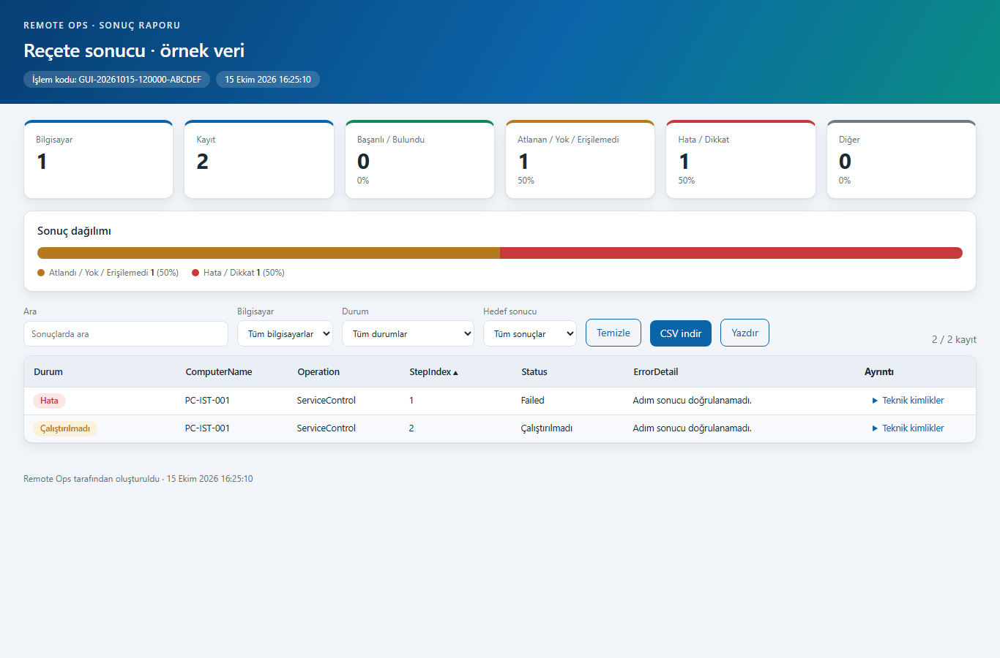

[Ayrıntı görünümü](screenshots-v19/rapor-ayrinti.png) · [Yüzde 125 görünümü](screenshots-v19/rapor-125.png) · [Doğrulama](V19_VALIDATION.json)

## v20 — Teşhis seçimi ve görev yedeği kodlaması

Hata Teşhisi çalışma listesinde operasyon adı, tarih/saat ve kayıtlıysa paket/reçete adı görünür. Örnek: **Paket dağıtımı · Örnek paket · 15.10.2026 13:58:32**. Teknik çalışma kimliği teşhis ayrıntısında korunur; seçim yine aynı kayıt nesnesine bağlıdır.

Görev silmeden önce alınan XML yedeğinde UTF-16 bildiriminin UTF-8 dosya baytlarıyla uyuşmaması Geri Alma Merkezi okumasını engelliyordu. Eski UTF-8 yedekler dosyaya yazılmadan okunur; gerçek BOM içeren UTF-16 yedekler de desteklenir. Yeni yedekler XML yazıcısıyla tutarlı UTF-8 olarak kaydedilir. DTD ve dış kaynak çözümleme yasakları, hedef kapsamı ve mevcut görevin üzerine yazmama kontrolleri korunur.

Bu hata daha önce geri alma yapılmış olmasına bağlı değildir. Önceden geri yüklenmiş görev hedefte mevcutsa tekrar geri alma işlemi mevcut görev üzerine yazmaz. Dosyanın okunabilmesi hedefte geri alma başarısı garantisi değildir.

Doğrulama yerel dosya örnekleri, sahte uzak sınırlar ve gerçek WPF çizimiyle yapılmıştır. Bu teslimde canlı uzak görev değiştirilmedi; Drive yüklemesi yapılmadı.

[Yüzde 125 görünümü](screenshots-v20/hata-teshisi-125.png) · [v20 doğrulaması](V20_VALIDATION.json)

## v21 — Anlaşılır teşhis ve geri alma durumları

Hata Teşhisi ekranında teknik ayrıntıların üstünde **Neden oldu?** ve **Ne yapmalıyım?** açıklamaları gösterilir. Bilinen sürüm atlama mesajı açıkça açıklanır; genel atlama veya bilinmeyen hata için kanıtsız bir neden atanmaz. Yetki/kaynak/doğrulama sınıfları kayıt işaretleridir; kesin kök neden iddiası değildir.

Geri Alma Merkezi yerel yedek durumu, eşleşen yerel geri alma geçmişi ve hedefin güncel durumunu ayrı gösterir. Eksik dosya veya okunamayan görev XML'i anlaşılır başlıkla belirtilir; özgün hata ayrıntıda kalır. Listeye bakmak hedefe bağlantı kurmaz. **Hedefin güncel durumu sorgulanmadı** ifadesi bu nedenle gösterilir.

v21 itibarıyla Geri Alma Merkezi üzerinden tamamlanan denemeler, çalışma raporu yanında **RecoveryReceipt.json** yerel sonuç kaydı üretir. Eşleştirme bilgisayar, kayıt kimliği, manifest özeti, yedek damgası, tür ve seçilmiş satır anahtarlarıyla yapılır. Kayıtlardaki başarı güncel hedef durumunun doğrulandığı anlamına gelmez. Eski çalışmalar ve diğer yollardan yapılan geri almalar için eşleşen kayıt bulunmayabilir; kayıt yokluğu hiç geri alınmadığını kanıtlamaz. Manifest veya yedek değişirse eski sonuç yeni kapsamın sonucu olarak gösterilmez.

**Son geri alma: başarılı bildirildi** yalnızca seçili kapsama ait yerel sonuçların başarı bildirdiğini söyler. Eksik/başarısız sonuçlarda tam başarı doğrulanmadığı belirtilir. Sonuç kaydı yazılamazsa uyarı kaydedilir; asıl uzak işlem sonucu değiştirilmez. Bu dosyalar yerel operatör kaydıdır, imzalı denetim kanıtı değildir.

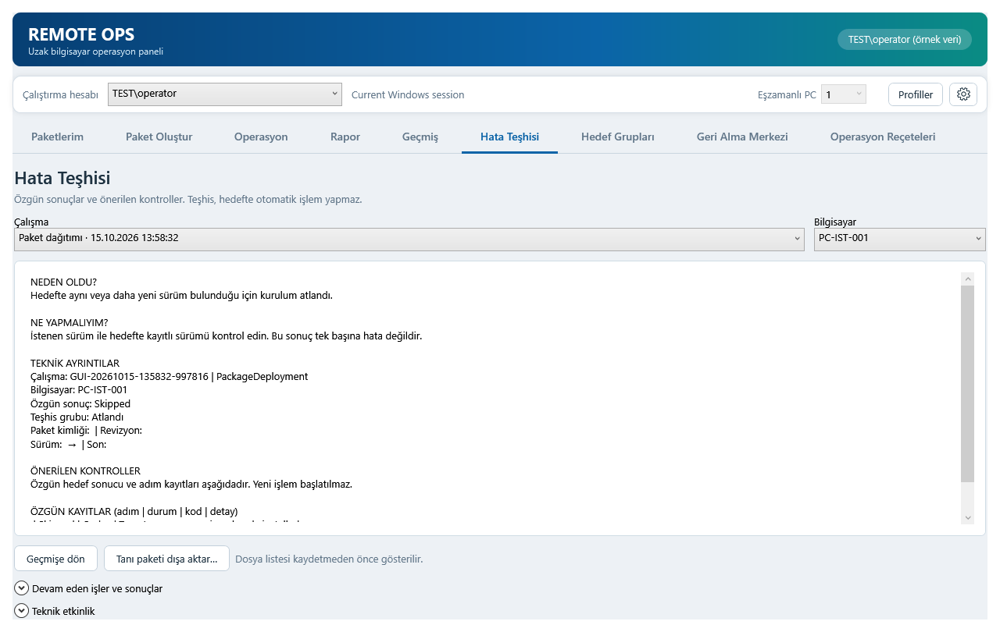

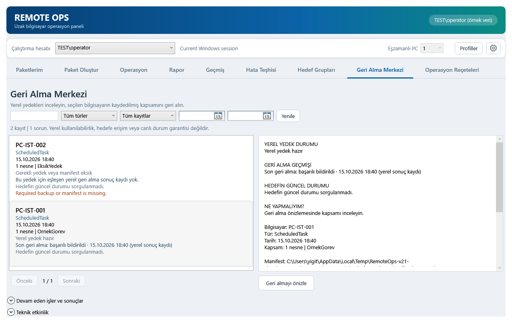

[Eksik yedek görünümü](screenshots-v21/geri-alma-eksik.png) · [Yüzde 125 görünümü](screenshots-v21/geri-alma-125.png) · [Doğrulama](V21_VALIDATION.json)

Ekranlar örnek verilerle gerçek WPF çizimidir. Testler yerel örnekler ve sahte uzak sınırlar kullanır; bu teslimde canlı uzak hedef değiştirilmedi. Drive yüklemesi yapılmadı. Önceki dağıtım korunur.
