# RemoteOps kullanım kılavuzu

16 Ekim 2026 · YD_RemoteOps.App_v28

## v28 — Otomatik sonuç doğrulama ve adım sonuçları

Servis başlatma, durdurma, yeniden başlatma ve başlangıç türü değişikliği sonrasında hedef tekrar okunur. Registry düzenlemede gerçek tür ve değer yeniden okunur; silmede değerin bulunmadığı kontrol edilir. Dosya gönderiminde gönderim öncesi kaynak özeti alınır; sonrasında kaynak sabitliği, hedef dosyaların SHA256 içerikleri ve klasörlerin varlığı/türü karşılaştırılır. Bu kontroller hem reçete adımlarında hem ilgili tekil işlemlerde otomatik uygulanır.

Komut yanıtı ve sonuç doğrulaması ayrı kaydedilir. “Doğrulandı” beklenen durumun kontrol anında görüldüğünü; “Beklenen sonuç oluşmadı” komut kabul edildiği halde sonucun farklı olduğunu; “Doğrulanamadı” son durumun okunamadığını veya kaynak değişimi gibi bir nedenle kesinleştirilemediğini anlatır. Komut başarısızsa veya gönderimde öğe atlandıysa doğrulama yapılmaz. Servis durum geçişinde en fazla 30 saniyelik bekleme penceresi kullanılır; her uzak okuma ayrıca en fazla 10 saniyelik sağlayıcı sınırına tabidir. Kontrol anındaki durumun daha sonra değişmeyeceği garanti edilmez.

Reçetede başarısız ya da belirsiz doğrulama o hedefte sonraki adımları durdurur; sonraki bilgisayarın reçetesi bağımsız devam eder. Tamamlanmış işlemler otomatik geri alınmaz, komutlar otomatik yeniden gönderilmez. Örneğin servis durdurulduktan sonra dosya gönderimi doğrulanamazsa servis başlatma adımı çalıştırılmaz. Geçmişte önceki adımın doğrulanmış durmuş durumunu ve sonraki adımın çalıştırılmadığını görebilirsiniz; bu geçmiş kaydı güncel canlı durum sorgusu değildir.

Geçmiş ekranında çalışma ve hedef seçildiğinde adım adı, komut yanıtı ve doğrulama sonucu görünür. Bir adım seçildiğinde beklenen ve gözlenen durum, açıklama ve UTC kontrol zamanı alt bölümde gösterilir. Çoklu koşullar tek adımda özetlenir; özgün satırlar CSV ve raporlarda korunur. HTML raporunda ayrıca okunabilir adım sonuçları tablosu vardır. Eski geçmiş kayıtlarında otomatik doğrulama kanıtı yoksa “Bu kayıtta otomatik doğrulama yok” yazılır.

Mevcut Recipe/1, /2, /3 ve /4 reçeteleri değiştirilmez; otomatik adlar, özel adlar, koşul grupları ve çalışma sırası korunur. Paket dağıtımının ve yedekleyerek silmenin önceki sonuç kontrolleri korunur; yeni servis/registry/gönderim kontrolü bunların yerine geçmez. Bağlantı/junction içeren dosya kapsamları doğrulanmış sayılmaz. Hedefte gönderim kapsamı dışında kalan dosyalar silinmez veya karşılaştırılmaz. Kaynak içerik özeti alınamıyorsa gönderim başlatılmaz.

Runtime C:\Temp\YD_RemoteOps.App ve katalog/profil yolları %APPDATA%\MDRemoteOps olarak kalır. Canlı hedeflere işlem yapılmadan yerel testler ve sınırlandırılmış SIM hedef modeliyle doğrulanmıştır; gerçek ağ, Windows sağlayıcısı, domain, SMB/PsExec ve EDR doğrulanmış değildir.

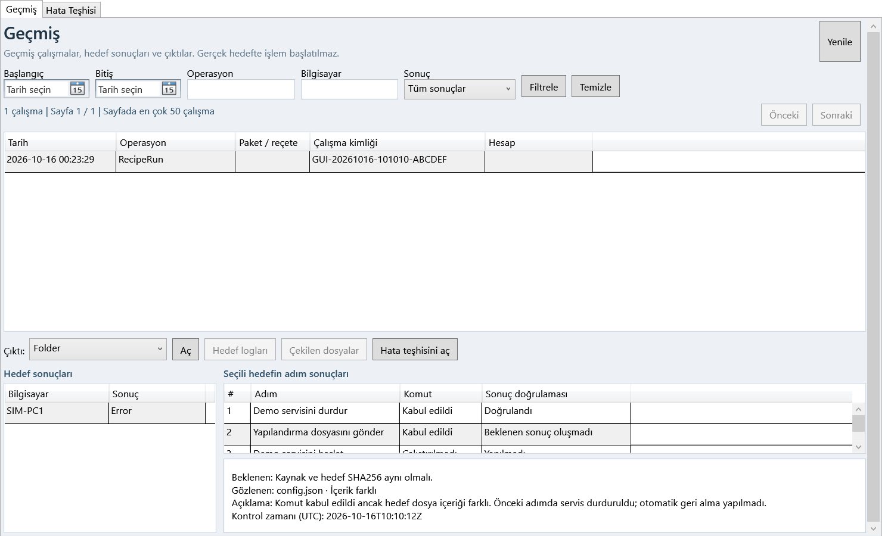

[Ayrıntılı v28 kapsamı ve test raporu](V28_TEST_RAPORU.md)

## Önceki teslimlerin tarihli referansları

Aşağıdaki v27 ve önceki bölümler tarihli arşiv açıklamalarıdır; v28 değişiklikleri yukarıda açıklanmıştır.

15 Ekim 2026 · YD_RemoteOps.App_v27

## v27 - v26 kodu için hafif operasyon kabul testi

Bu teslim uygulama davranışını değiştirmez. RemoteOps.App ve Modules içindeki 36 üretim dosyası v26 ile birebir aynıdır. v26 kaynak ve ZIP korunmuştur. Yeni teslim hafif test araçları, kayıtlar ve kabul raporunu ekler.

Gerçek WPF reçete oluşturma, otomatik ad, adım içi koşul, kaydetme/yeniden açma, önizleme ve RECETE onayı; gerçek koordinatör ve çocuk süreçleriyle sınandı. Uzak erişim sınırında yerel, durumu değişen servis/registry modeli kullanıldı. 17/17 operasyon senaryosu, 12/12 yerel regresyon dosyası ve 5/5 sınır negatif kontrolü geçti. Bağımsız inceleme 16 çalışma kaydını doğruladı. Çalışma yaklaşık 149 saniye sürdü; gözlenen toplam çalışma belleği yaklaşık 700 MiB idi. Sanal makine kullanılmadı.

Yanıltıcı Success raporu hedef durumuyla ayrıca karşılaştırıldı ve reddedildi. Koşul atlama/durdurma, All/Any, okuma/işlem hatası, iptal, hedef bağımsızlığı ve eski ortak koşul davranışı doğrulandı. Gerçek ağ/Windows sağlayıcısı, domain hesabı, SMB/PsExec ve EDR testi yapılmadı. Durdur onay kutusu yerine aynı gerçek iptal isteği mekanizması çağrıldı.

[Ayrıntılı kabul raporu](V27_HAFIF_TEST_RAPORU.html) · [Kod eşitliği](V26_CODE_IDENTITY.json)

Tekrar çalıştırmak için kökte HAFIF_TEST_CALISTIR.bat dosyasını açın. Çıktılar yeni tarihli klasöre yazılır. Kişisel veri yolları testte geçici dizine yönlendirilir; gerçek uygulamanın C:\Temp\YD_RemoteOps.App ve AppData yolları değişmez.

## v26 arayüzü ve önceki teslimlerin referansı

Aşağıdaki ekran görüntüleri ve v26 açıklamaları aynı kalan uygulama arayüzünün referansıdır. v27 yalnızca test teslimidir.

15 Ekim 2026 · YD_RemoteOps.App_v26

## v26 - Adımın içinde koşul ve otomatik adlandırma

Reçete ekranı adım listesine odaklanır. İşlem alanlarını doldurmak için Adım ekle veya seçili adımı düzenleme komutunu kullanın. Düzenleme ayrı pencerede açılır; işlem bilgileri ve çalışma koşulu ayrı bölümlerde tutulur. Ana sayfada aşağı kaydırarak alan aramak gerekmez. Uzun listeler kendi alanında kaydırılabilir.

Adım adına ayrıca metin yazmak gerekmez. İşlem ve ilgili servis, dosya veya registry bilgileri adı oluşturur. Örneğin Servisi başlat · Spooler. İsterseniz adı özelleştirebilirsiniz; eski reçetelerde verdiğiniz özel adlar korunur.

İlgili adımın çalışma koşulunda servis veya registry kontrolü tanımlayın. Registry değerinde tür seçilmez: 1 veya 16.0.444 gibi beklenen değeri girin. Gerçek hedef türüne göre karşılaştırma yapılır. Servis koşulunda yalnızca servisle ilgili alanlar görünür. Birden fazla kontrol için Tümü / Herhangi biri davranışı korunur. Koşul sağlanmazsa adımı atlama veya hedefin reçetesini durdurma seçilebilir.

Otomatik adlandırma tercihi yeni Recipe/4 biçiminde saklanır; yeniden açıldığında da güncellenir. Eski reçeteler ve özel adlar korunur. Yeni biçimdeki reçeteleri açmak için v26 gerekir.

Mevcut ortak koşulların bağlı adımları ve tek kez değerlendirilme davranışı korunur. Eski ortak koşul değiştirilirse aynı koşula bağlı bütün adımları etkiler; düzenleyici bu kapsamı belirtir. Yeni koşullar ilgili işlemle birlikte yönetilir. Uyumsuz sıra değişiklikleri engellenir. Düzenlemeden vazgeçmek kayıtlı reçeteyi veya taslağı değiştirmez.

Hedefler ayrı bölümde yönetilir; ortak hedef araçları korunur. Reçeteyi kaydetmek hedefte işlem başlatmaz. Kaydedilmiş reçetenin önizlemesi ve RECETE çalıştırma onayı devam eder. Gerçek uzak hedef testi bu teslimde yapılmamıştır.

## Önceki sürümlerin tarihsel açıklamaları

Aşağıdaki v25 ve daha eski bölümler kendi teslimlerini anlatır. Güncel v26 kullanımında üstteki adım düzenleme akışı geçerlidir.

15 Ekim 2026 · YD_RemoteOps.App_v25

## v25 — Kolay koşul oluşturma ve otomatik değer karşılaştırması

Koşullar artık ayrı bir Koşul ekle düğmesi yerine Adım ekle akışındadır. Yeni adımın Adımda ne yapılsın? listesinden Koşul: Registry değerini kontrol et, Koşul: Registry anahtarını kontrol et veya Koşul: Servisi kontrol et seçilir. Servisi başlat/durdur/yeniden başlat normal bir işlemdir; servis koşulu salt okunur kontroldür.

Registry değeri için yalnızca yolu, değer adını, Eşit/Eşit değil seçimini ve karşılaştırılacak değeri girin. Örneğin Version için 16.0.444 veya Mode için 1 yazın. Registry türü seçilmez: uygulama hedefte kayıtlı gerçek türü okur ve girdiğinizi o türe göre karşılaştırır. Metin değeri metin olarak, sayı değeri sayı olarak ele alınır. Olası türler sırayla denenmez. Sürüm metni sayıya çevrilmez. Sayı türüne uymayan beklenen metin eşit değildir; hedef okunamadıysa bu bir karşılaştırma sonucu sayılmaz ve o bilgisayardaki reçete durur.

Registry anahtarı seçildiğinde yalnızca yol ve var/yok kontrolü görünür. Registry değeri için Var/Yok seçildiğinde beklenen değer alanı da kapanır. Değer adı boş bırakılırsa varsayılan registry değeri kullanılır. Eksik değer Eşit değil koşulunu sağlamaz; eksikliği denetlemek için Yok seçilir. Metin karşılaştırması büyük/küçük harfe duyarlıdır.

Servis seçildiğinde registry yolu, registry türü ve serbest değer alanları görünmez. Servis adı ve kontrol amacı seçilir: Var/Yok, Servis durumu veya Başlangıç türü. Durum ve başlangıç Türkçe açılır listeden seçilir: Çalışıyor/Durduruldu ve Otomatik/El ile/Devre dışı gibi. Teknik sistem değerlerini yazmak gerekmez.

Tek kontrolde gereksiz Tümü/Herhangi biri seçimi gizlidir. Ek kontrol eklendiğinde bu seçenek görünür. Koşul sağlanmazsa bağlı adımları atlama veya o bilgisayarın reçetesini durdurma seçimi alanların altındadır. İlgili normal adımın Adımın koşulu alanından önceki koşula bağlanması, kapsam korumaları ve mevcut çalıştırma onayları devam eder. Önizleme koşulları cümleyle anlatır; hedefi sorgulamaz.

Mevcut koşulsuz ve v24 koşullu reçeteler açılır. Eski karşılaştırma değiştirilmeden kaydedilirse kayıtlı tür kısıtı korunur. Eski koşulda beklenen değer veya karşılaştırma değiştirilirse yeni otomatik karşılaştırma kullanılır. Yeni otomatik koşullar v25 gerektirir; eski uygulamalar bu yeni reçete biçimini açamaz. Önceki dağıtım ve kişisel veri yolları korunur.

Çok satırlı registry değerinde her öğeyi ayrı satıra yazın; JSON bilmek gerekmez. Satır sırası, boşluklar ve boş satırlar önemlidir. Boş metin tek boş öğedir, sıfır öğeli dizi değildir. CRLF/LF satırları böler; tek CR harfi verinin parçası kalır. Önceden kayıtlı açık tür karşılaştırmaları değiştirilmedikçe eski kuralları kullanır. Desteklenen hedef türleri mevcut beş registry türüdür; desteklenmeyen veya bozuk hedef verisi hata olarak raporlanır.

Bu teslimde gerçek uzak hedef değiştirilmedi. Ekranlar yalıtılmış örnek verilerle gerçek WPF çizimidir. Aşağıdaki eski sürümlerin tür seçtiren veya ayrı Koşul ekle düğmeli açıklamaları tarihsel bilgidir; v25 arayüzünü anlatmaz.

15 Ekim 2026 · YD_RemoteOps.App_v25

## v24 — Registry ve servis koşullu reçeteler

Mevcut koşulsuz reçeteler aynı sırayla ve aynı onaylarla çalışır. Koşul eklenen reçeteler yeni şemayla kaydedilir; v23 ve daha eski uygulamalar bu yeni reçeteleri açamaz. Mevcut kişisel reçeteler otomatik dönüştürülmez.

Operasyon Reçeteleri ekranında Koşul ekle düğmesini kullanın. Koşula ad verin, Tümü sağlansın veya Herhangi biri sağlansın seçin. Denetim ekle ile bir grupta 1–10 kontrol tanımlayın. Registry anahtarı/değeri için Var/Yok, registry değeri için Eşit/Eşit değil; servis için Var/Yok, Servis durumu veya Başlangıç türü seçilebilir. Servis adını tam yazın. Durum için Running/Stopped gibi sistem değerleri, başlangıç türü için Automatic/Manual/Disabled kullanılır.

Registry karşılaştırmaları türü dikkate alır. REG_SZ, REG_EXPAND_SZ, REG_DWORD, REG_QWORD ve REG_MULTI_SZ desteklenir. Sayılar ondalık veya 0x biçiminde; çoklu metin JSON dizisi olarak girilir. Metinler büyük/küçük harfe duyarlı karşılaştırılır. Değerin bulunmaması Eşit değil koşulunu sağlamaz; bunun için ayrı Yok kontrolünü seçin. Anahtar kontrolünde değer adı ve beklenen tür/değer boş kalır. Servis kontrolünde registry yolu ve beklenen registry türü boş kalır. HKCU mevcut registry modülleriyle aynı tek etkileşimli kullanıcı SID çözümlemesini kullanır; belirsiz kullanıcı hatadır.

Koşuldan sonra normal Adım ekle ile işlemleri oluşturun. İlgili işlemde Adımın koşulu listesinden önceki koşulu seçin. Bağlı adımlar koşulun hemen ardından kesintisiz sıralanmalıdır; girintili görünür. Koşulsuz seçilen adım koşul bloğunu bitirir. Sonraki yeni koşul yeni bir blok başlatır. İç içe koşul ve ileri adıma başvuru yoktur. Bağlı adımları olan koşul doğrudan silinmez; önce bağlantıları düzenleyin. Geçersiz yeniden sıralama geri çevrilir. Reçete kopyalandığında koşul bağlantıları yeni kimliklerle korunur.

Yanlış sonuçta Bağlı adımları atla seçilirse yalnızca o koşula bağlı işlemler atlanır; sonraki koşulsuz adımlar devam eder. Bu hedefin reçetesini durdur seçilirse o bilgisayarda kalan işlemler başlamaz; sonraki bilgisayara geçilir. Erişim reddi, hatalı/eksik sağlayıcı sonucu ve okunamayan durum koşulun yanlış olması değildir: o hedef durur. Herhangi biri seçili ve bir kontrol doğru olsa bile başka kontrolde hata varsa işlemler başlamaz.

Koşullar her hedefte kendi adımına gelindiğinde salt okunur sorgularla değerlendirilir. Önizleme koşulları sorgulamaz; tanımları, bağlı adımları ve hesabı gösterir. Kaydedip önizlemeyi açın; mevcut RECETE onayı geçerlidir. Çalışma raporu her kontrolde beklenen/okunan değer ve eşleşmeyi, koşul nedeniyle atlanan işlemleri ve hataları saklar. Alt süreç sonuçları onaylı kontrol tanımına bağlanır; eksik veya tutarsız kanıt bağlı değişikliği başlatamaz.

Örnek: Mode değeri mevcut ve Enabled değilse VE OrnekServis durmuşsa ayarı güncelle, servisi başlat. Mode yoksa gruptaki Eşit değil yanlış olur; eksik değeri de kapsamak isterseniz Yok için ayrı bir koşul grubu tasarlayın.

Sınırlar: toplam 20 adım sınırına koşul adımları da dahildir; grup başına 10 denetim. Koşul ile bağlı işlem arasında hedef durumu değişebilir; atomik işlem veya otomatik geri alma değildir. REG_EXPAND_SZ kayıpsız okumada mevcut Remote Registry yardımcısının erişim gereksinimleri geçerlidir. Bu teslim yerel sahte sınır ve WPF testleriyle doğrulanır; canlı şirket hedefi değiştirilmedi. Aşağıdaki eski sürüm açıklamaları tarihsel bilgidir; geçmişte koşul olmadığına ilişkin ifadeler v24 kapsamını anlatmaz.

15 Ekim 2026 · YD_RemoteOps.App_v25

## v23 — Ortak hedefler, sonuç filtreleri ve geçişler

Tek operatör için ikinci aşama. Paketlerim, Operasyon ve Operasyon Reçeteleri ekranlarında aynı hedef araçları bulunur. Seçili tekil hedef ve tekrar sayısı giriş sırasında güncellenir. Tekrarları temizle ilk yazılan adı koruyarak listeyi düzenler; geçersiz ad varsa girdi değişmez. Hedefleri düzenle penceresinde bilgisayar arayın, bir veya birden fazla hedefi seçip çıkarın ve Listeyi uygula ile kaydedin. Arama yalnızca görünümü süzer; aramada görünmeyen hedefler korunur. Vazgeç değişiklikleri uygulamaz. Açık pencere sırasında asıl hedef alanı değişirse eski liste uygulanmaz.

Hedefler üç ekran arasında otomatik eşitlenmez ve diske yeni bir ortak hedef listesi yazılmaz. Hedef gruplarına git kaydedilmiş kişisel listelerin ekranını açar; grubu hedef alanına aktarmak için dönüp Ekle/Değiştir seçilir. Her çalıştırmada mevcut önizleme ve onaylar geçerlidir.

Devam eden işler ve sonuçlar panelinde bilgisayar adı ve özgün sonuç kodu birlikte filtrelenebilir. Görünen / toplam hedef sayısı gösterilir; Filtreleri temizle bütün satırları geri getirir. Kaynak sonuç ve raporlar değişmez. İlerleme yenilenirken seçim çalışma ve bilgisayar kimliğiyle korunur; gizlenen satırın eski eylemleri açık kalmaz. Geçmiş ekranında hedef tablosu için ayrıca bilgisayar/sonuç filtresi vardır. Çalışma filtresi ile hedef filtresi ayrı kapsamları süzer.

Seçili sonucu teşhis et, ilgili çalışmanın rapor kökü ve hedefi eşleşiyorsa doğru teşhisi açar. Rapor henüz oluşmadıysa açıklama gösterilir. İzleme, Geçmiş ve Hata Teşhisi ekranlarından seçili bilgisayarın yedeklerine geçilebilir. Bu geçiş Geri Alma Merkezi filtrelerini ilgili bilgisayara ayarlar, önceki tür/tarih filtrelerini temizler ve bir geri alma kaydını otomatik seçmez. Hedefe bağlanmaz; geri alma başlatmaz.

Bu teslimde uzak motor, çalışma hesapları, C:\Temp\YD_RemoteOps.App ve AppData yolları korunur. Gerçek uzak hedef testi yapılmadı. Ekranlar örnek verilerle gerçek WPF çizimidir. Aşağıdaki eski sürüm bölümleri ve ekranlar tarihsel bilgi olarak korunur.

15 Ekim 2026 · YD_RemoteOps.App_v25

## v22 — Tek operatör için yeni ekran düzeni

Uygulama tek operatör tarafından kullanılır. Farklı çalışma profilleri aynı operatörün uzak hedeflerde kullandığı hesaplardır. Ekip kataloğu, çok kullanıcılı onay veya operatörler arası merkezi kilit bu teslimin kapsamı değildir.

Üst sekmeler yerini üç gruplu sol menüye bırakır: Çalıştır (Paketlerim, Operasyon, Operasyon Reçeteleri), Hazırla (Paket Oluştur, Hedef Grupları), İncele ve Kurtar (Rapor, Geçmiş, Hata Teşhisi, Geri Alma Merkezi). Dokuz mevcut ekran ve Yeni paket / Düzenle gibi geçişler korunur. Dar pencerede menü kaydırılabilir. Uygulama başlığında kökteki VERSION.json sürümü görünür.

Teşhiste sonuç nedeni ve sonraki adım ayrı kartlardır. Özgün kayıtlar Teknik ayrıntılar ve özgün kayıtlar bölümünde açılır. Geri almada yerel yedek, son yerel sonuç ve hedefin güncel durumu ayrı kartlardır. Güncel durum otomatik sorgulanmaz; geçmişteki başarı hedefte şu an doğrulama yapıldığı anlamına gelmez. Kapsam ve teknik ayrıntılar açılır bölümde kalır. Filtrelerde kalıcı alan etiketleri vardır; liste ve ayrıntı genişlikleri ayarlanabilir.

Çalıştırma hesabı ve paralellik üstte, devam eden işler ile teknik etkinlik altta kalır. Yürütme motoru, onaylar, uzak işlem davranışları, C:\Temp\YD_RemoteOps.App ve AppData katalog/profil yolları değiştirilmedi. Bu teslim için uzak hedeflerde canlı test yapılmaz; ekranlar yalıtılmış örnek verilerle çizilir. Aşağıdaki önceki sürüm bölümleri tarihsel bilgi ve özellik açıklamasıdır; eski üst sekmeli görseller v22 gezinmesini göstermez.

15 Ekim 2026 · YD_RemoteOps.App_v25 · Operatör rehberi

Bu kılavuz sol menüden erişilen dokuz ekranı ve şirket pilotunda izlenecek yolu açıklar. Ekranlar gerçek WPF kontrollerinden örnek verilerle üretilmiştir; şirket ağında yapılmış test sonucu değildir. Ayrıntılı yapı [teknik el kitabında](TEKNIK_EL_KITABI.md), süreç akışı [çalışma mantığında](CALISMA_MANTIGI.md) bulunur.

## 1. Şirket bilgisayarına taşıma

1. Klasörün tamamını kopyalayın; Modules ve RemoteOps.App birlikte kalmalıdır.
2. Kökteki YD_RemoteOps.App.bat dosyasını açın. Windows PowerShell 5.1, WPF ve FullLanguage çalışma ortamı gerekir.
3. Profili şirket bilgisayarında tanımlayın. İlk pilotta paralel bilgisayar sayısını 1 seçin.
4. Önce tek test hedefinde uygulama envanteri alın; gerçek kimlik/sürüm bilgisini kaydedin.
5. [Pilot kontrol tablosunu](PAKET_YONETIMI_PILOT_KONTROLU.md) doldurup dağıtım senaryolarına geçin.

Kişisel profil dosyasını başka bilgisayara taşımayın; parolalar Windows kullanıcı hesabına bağlı DPAPI ile korunur. Paket tanımları JSON dışa/içe aktarımıyla taşınabilir. Veri kökü kaynak klasör adı değişse de C:\Temp\YD_RemoteOps.App olarak kalır. Şirket ağında gerekli uzak yönetim erişimleri teknik el kitabında açıklanır.

## 2. Ekran düzeni ve hesap seçimi

Üst hesap ve paralellik seçimi bütün sekmeler için ortaktır. Paketlerim varsayılan sekmedir. Paket Oluştur kayıt düzenler, Operasyon diğer bakım işlerini açar, Rapor günlük özeti gösterir. Geçmiş önceki çalışmaları ve çıktıları, Hata Teşhisi özgün hata ayrıntılarını gösterir; bu iki sekme hedefte yeni işlem başlatmaz. Devam eden işler ve sonuçlar alt paneli bütün sekmelerden izlenebilir; yeni işte açılır. Teknik aktivite ayrıntılı çıktıdır.

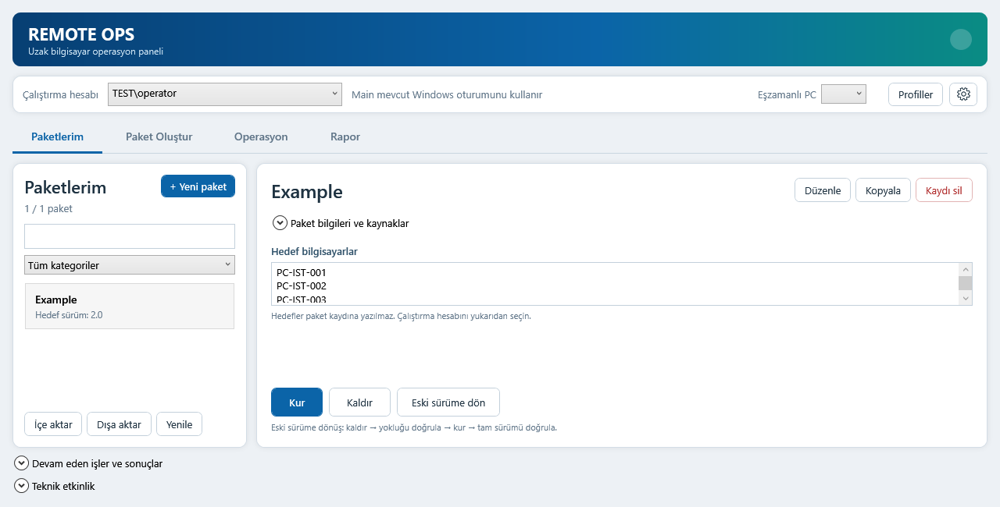

Şekil 1. Paketlerim: solda arama/kayıt listesi, sağda paket ayrıntıları ve hedefler, sabit alt bölümde Kur/Kaldır/Eski sürüme dön. TEST hesabı ve örnek sunucu/bilgisayarlar eğitim verisidir.

Main mevcut Windows oturum token'ıyla çalışır; kaydındaki parola oturumu değiştirmez. Başka hesap için Profiller düğmesiyle ayrı profil oluşturup üst listeden seçin. Alternatif hesap uygulama/modül/PsExec dosyalarını okuyabilmeli, veri alanına yazabilmeli ve hedefleri yönetebilmelidir.

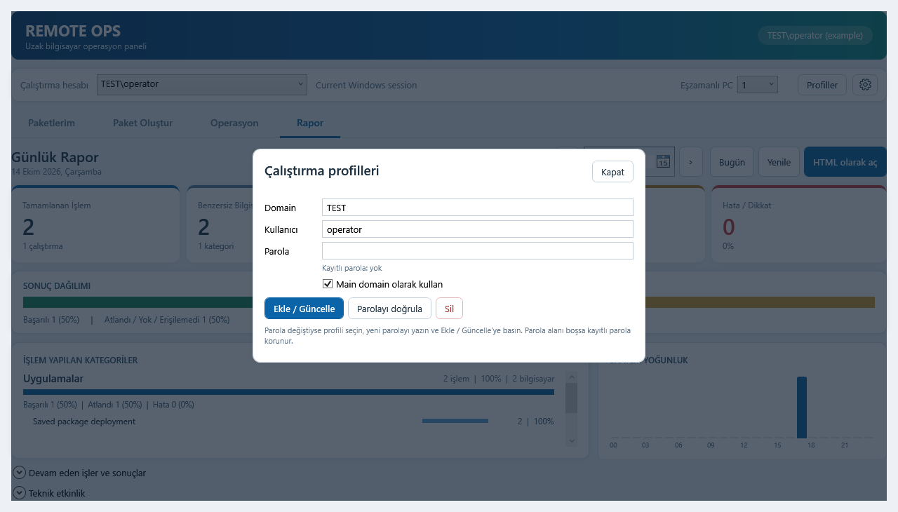

Şekil 1a. Profiller paneli. Görselde parola ve gerçek şirket hesabı bulunmaz; başka bilgisayarda profiller yeniden tanımlanır.

Paket hedefte SYSTEM olarak çalışır. Yönetici hesabının UNC klasörünü açabilmesi SYSTEM erişimini kanıtlamaz. Kaydedilmiş dağıtım kaynak dosyasını SYSTEM altında salt okunur probe ile sınar. Scriptin çağırdığı ek dosyaların erişimi ayrıca pilotta doğrulanmalıdır.

## 3. Paket Oluştur

Bu ekran mevcut .bat/.cmd/.ps1/.vbs scriptini tanımlar; yeni MSI, EXE veya script üretmez. Kaydetme hedefte işlem başlatmaz.

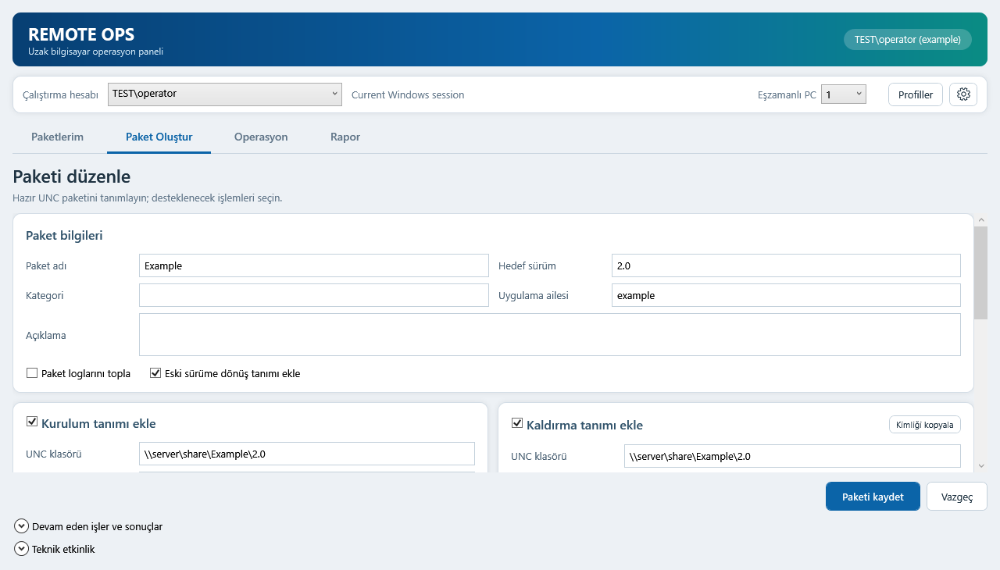

Şekil 2. Paket genel bilgileri. Uzun içerik kaydırılır; kaydetme alanı altta kalır.

1. Ad, kategori, açıklama, hedef sürüm ve uygulama ailesi anahtarını girin. Aynı uygulamanın tüm sürümlerinde aynı aile anahtarını kullanın.
2. Kurulum eylemini açın; UNC klasörünü ve ayrı dosya adını girin. Örnek: \\paket-sunucusu\Dagitim\OrnekApp\2.0 ve install.cmd.
3. Arama türü, uygulama kimliği ve kontrol modunu seçin. Gerekirse tam RegistryKey ile eşleşmeyi daraltın.
4. Kaldırma gerekiyorsa ayrı eylemi açıp kaldırma kaynağı/kimliğini girin. Sürümler arasında ProductID değişebilir.
5. Eski sürüme dönüş tanımı ekle kutusunu açın. Ayrı alana eski hedef sürümünü, eski sürüm UNC klasörünü/scriptini ve uygulama kimliğini girin. Kaldırma tanımı da etkin olmalıdır. Normal kurulum paketi bu eylemde kullanılmaz.
6. Gerekiyorsa log toplamayı açın. Kaydet'e basıp hata açıklamalarını giderin.

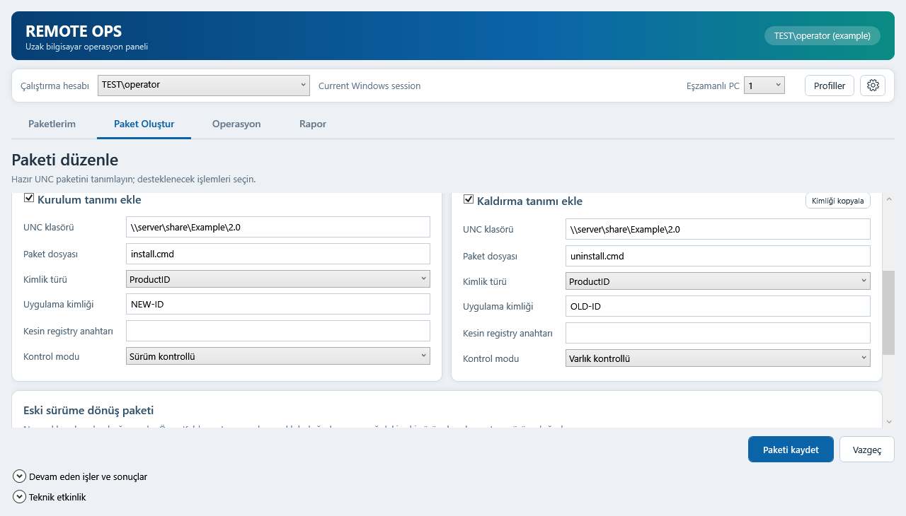

Şekil 2a. Editör aşağı kaydırıldığında iki eylem görünür. NEW-ID ve OLD-ID örnek kimliklerdir; gerçek değerler şirket uygulama envanterinden alınmalıdır.

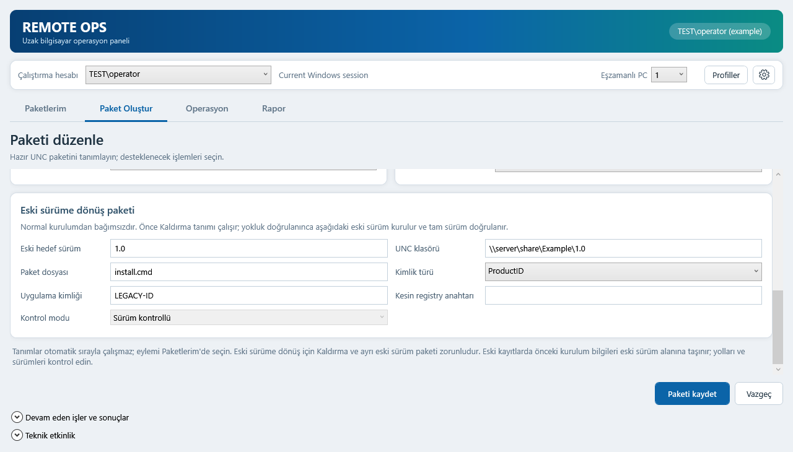

Şekil 2c. Eski sürüme dönüş için ayrı UNC/script, eski hedef sürüm ve kimlik. Örnekte normal kurulum 2.0, eski hedef 1.0'dır. Bu eylem önce Kaldırma tanımını kullanır, yokluğu doğrular ve yalnızca bu alandaki eski paketi kurar. Normal Kur ve Kaldır birbirinden bağımsız seçilir; tanımların birlikte işaretlenmesi otomatik zincir başlatmaz.

| Alan/seçim | Anlamı |
| --- | --- |
| UNC klasör / Dosya | Paylaşım klasörü ve yalnızca .bat/.cmd/.ps1/.vbs dosya adı. |
| DisplayName exact | Uninstall kaydındaki görünen adın tam eşleşmesi. |
| DisplayName contains | Ad içinde arama; çoklu eşleşme ihtimalini kontrol edin. |
| ProductID | Uninstall kayıt kimliği; gerçek değeri ApplicationInventory ile doğrulayın. |
| RegistryKey | İsteğe bağlı tam anahtar sınırı; yanlış anahtar tespiti engeller. |
| Version controlled | Varlık ve sürüm kontrolü. Normal Kur hedef veya üst sürümü kabul eder. |
| Presence only | Varlık/yokluk kontrolü; sürüm eşitliği aranmaz. |
| Trigger without checks | Uygulama doğrulaması olmadan tetikleme; kuruldu/kaldırıldı kanıtı değildir. |

Script sessiz çalışmalı ve gerçek yükleyici exit code'unu iletmelidir. EXE/MSI uygun script içinden çağrılır. SYSTEM yürütmesi kullanıcıya soru soran paketler için uygun değildir. Scriptin kendi davranışı da şirket pilotunda kontrol edilir.

## 4. Paketlerim: yönetme ve paylaşma

Arama/kategori ile paketi bulun. Düzenle aynı kaydı günceller; Kopyala yeni GUID'li kayıt üretir, aile anahtarını korur. Yeni sürüm tanımı için kopyalama kullanılabilir. Sil katalog kaydını siler; hedefte yazılım veya UNC dosyası silmez.

Dışa aktar tanımları JSON ile paylaşır. İçe aktar doğrulama ve çakışma önizlemesi yapar; Atla/Kopyala/Değiştir politikası seçilir. Parola, hedef listesi ve onay aktarılmaz. Alınan tanımın kaynak ve kimliklerini şirket ortamında kontrol edin. Katalog kişiseldir: %APPDATA%\MDRemoteOps\Packages. Revizyon çakışmasında en güncel kaydı yeniden açın.

## 5. Kur veya Kaldır

1. Doğru paket/sürümü ve üst çalışma hesabını seçin.
2. Hedef alanına bilgisayar adlarını girin; satır, boşluk, virgül veya noktalı virgül ayırıcı kullanabilirsiniz. Tekrarlar temizlenir.
3. Kur/Kaldır'a basın; özette hesap, hedefler, eylem, kaynak ve kimlikleri kontrol edin.
4. İstenen onayı tam büyük harfle TRIGGER yazıp çalıştırın. Özet açıkken hesap değiştiyse özeti yeniden açın.
5. Aşamaları ortak izleme panelinden takip edin; sonuç raporunu inceleyin.

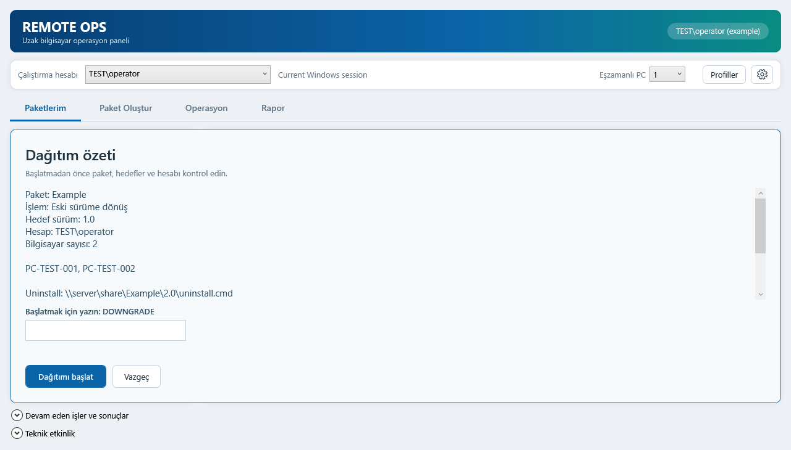

Şekil 2b. Downgrade için örnek çalıştırma özeti; hesap, hedefler, iki kaynak ve onay birlikte gösterilir. Görselde iş başlatılmamıştır.

Çalışma bağımsız tanım snapshot'ını kullanır; sonraki katalog düzenlemesi işi değiştirmez. Kontrollü Kur hedef veya daha yeni sürüm kuruluysa atlayabilir. Kontrollü Kaldır uygulama yoksa atlar; çalıştırdıysa yokluğu doğrular. Kontrolsüz tetikleme uygulama varlığını/sürümünü ayrıca doğrulamaz.

## 6. Eski sürüme dön

Paket ve hedefleri seçip Eski sürüme dön eylemini açın; özette DOWNGRADE onayını kullanın. Akış: mevcut kimlik/sürüm; kaldırma ve ayrı eski sürüm kaynaklarına erişim; kaldırma; yokluk doğrulaması; eski sürüm paketini kurma; eski hedef sürümün tam doğrulaması.

| Durum | Davranış |
| --- | --- |
| Daha yeni sürüm ve doğru kaldırma kimliği | İki kaynak doğrulandıktan sonra downgrade. |
| Eşit, daha eski veya uygulama yok | Skipped; gerekiyorsa Kur kullanın. |
| Kaynak erişilemiyor, kimlik belirsiz/yanlış | Değişiklikten önce durur. |
| Kaldırma hata veya uygulama hâlâ var | Kurulum başlamaz. |
| Kaldırma 3010/1641 | RebootRequired; otomatik kurulum/reboot yok. |
| Kaldırma bitti, kurulum başarısız | Kaldırılmış durum adım kaydında görünür; otomatik geri kurulum yok. |
| Son sürüm hedefe eşit değil | Başarı sayılmaz; detay incelenir. |

Downgrade transaction/otomatik rollback değildir. Pilot öncesinde kurtarma paketini ve sorumlusunu belirleyin. Sayısal karşılaştırılamayan sürümlerde zorla downgrade yapılmaz.

## 7. Durdurma ve belirsiz sonuç

Tamamlanan sayısı girişimi biten hedeflerdir; hepsi başarılı olmayabilir. Aşama ve sonuçla birlikte okuyun. Kaydedilmiş dağıtımda Durdur yeni hedef/adımı engeller; aktif paket adımını bekler. Zorla durdur yerel süreç ağacını kapatır. Uzak paket devam edebilir; sonucu doğrulanamayan hedef Indeterminate olur. Checkpoint verilerinden kısmi rapor hazırlanır.

Diğer operasyonlarda Durdur yerel süreç sonlandırmadır; aynı kısmi rapor davranışı her işlemde geçerli değildir. Pencereyi çalışırken kapatmak takibi keser; tam uygulama çökmesinden sonra otomatik devam yoktur. Timeout/force stop/Indeterminate sonrasında hedefte yükleyici, varlık/sürüm ve logları kontrol etmeden tekrar dağıtım yapmayın.

## 8. Diğer operasyonlar

Operasyon sekmesi seçilen iş için alanları gösterir. Manuel Install or uninstall package formu kayıt oluşturmadan kur/kaldır çalıştırır; Bu tanımı paket olarak kaydet kısayolu vardır. Manuel form downgrade sağlamaz. Kısayol Paketi Oluştur editörünü doldurur; doğrudan kaydetmez. Paket adını değiştirebilir ve kategori girebilirsiniz. Paketi kaydet düğmesiyle kişisel kataloğa eklenir; hedefler ve onay taşınmaz.

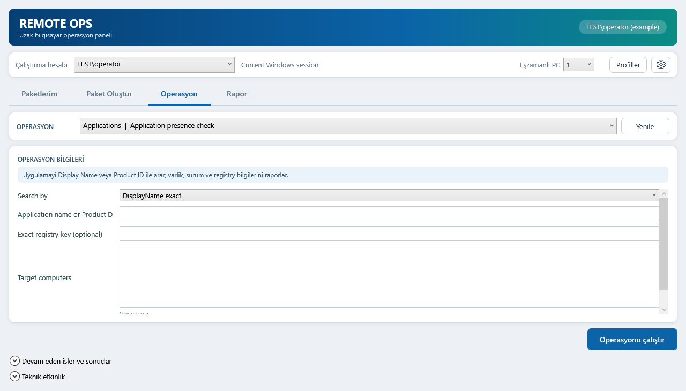

Şekil 3. Güncel Operasyon ekranı; örnek verilerle, uzak işlem başlatılmadan.

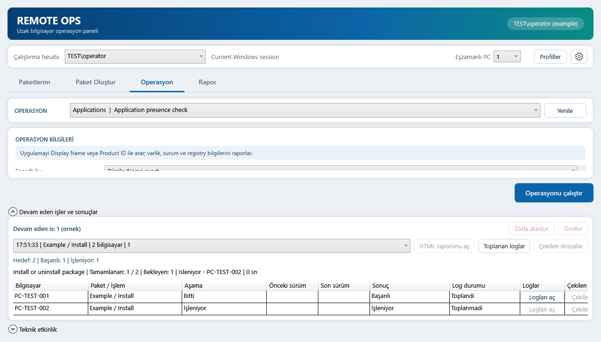

Şekil 3a. Manuel paket ve diğer operasyonlarda bilgisayar, paket/işlem etiketi, bekleme/çalışma/bitiş ve sonuç ortak tabloda görünür. Görsel örnek ilerleme verisidir; gerçek hedef çalıştırılmamıştır. Eşzamanlı işler birbirinin satırlarını ezmez.

Devam eden işler ve sonuçlar panelinde yeni iş başlayınca yalnızca son çalıştırma seçilir. Saat, paket/eylem, hedef sayısı ve oturum sıra numarasıyla önceki çalıştırmaları seçebilirsiniz. Seçim geçmiş sonuçları silmez; arka plandaki güncellemeler seçimi değiştirmez. Tüm çalışmalar seçildiğinde bilgisayar satırları çalıştırma başlıkları altında gruplanır; aynı bilgisayar farklı işlerde ayrı satırdır. Seçili çalıştırmanın hedef/durum sayıları tabloda gösterilir. HTML raporunu aç düğmesi yalnızca seçili işin raporu oluştuğunda etkinleşir; toplu görünümde kapalıdır. Üstteki devam eden iş sayısı bütün aktif işleri gösterir.

Bu seçim geçmişi açık uygulama oturumuna aittir; yeniden açılışta boş başlar. Kalıcı raporlar Rapor sekmesinde ve log klasörlerinde korunur. Durdur/Zorla durdur düğmeleri mevcut davranışla bütün aktif işleri etkiler; çalışma seçimi durdurma kapsamını değiştirmez.

| Grup | İşlev / kullanım sınırı |
| --- | --- |
| Applications | Varlık ve uygulama envanteri, manuel paket; gerçek kimliği buradan doğrulayın. |
| Files | Çek/gönder/karşılaştır/yedekle-sil/taşı/değiştir. Restore silme yedeği, Rollback dosya manifesti kullanır. |
| Inventory | Uç nokta ve ayrıntılı sağlık. HealthCheck tüm liste için tek Health.html üretir. |
| Registry | HKLM/HKCU/HKU (kısa veya uzun kök adı) REG_SZ, REG_DWORD, REG_QWORD, REG_MULTI_SZ, REG_EXPAND_SZ okuma/değiştirme/silme/geri alma. |
| Services | Liste, Start/Stop/Restart, başlangıç türü/geri alma; tam servis adı kullanılır. |
| Tasks | Liste/Run/Enable/Disable/XML yedekli silme; aynı ad varsa görev yolu gerekir. |
| Processes | Ad/PID sorgu ve tam ad/PID kill; kritik süreçler korunur, kill geri alınmaz. |

Değişiklikte ekrandaki onayı tam yazın: DELETE, EDIT, RESTORE, ROLLBACK, KILL veya eylem adı START/STOP/RESTART/RUN/ENABLE/DISABLE/MOVE/REPLACE. Görev silmede parola tabanlı görevler korunur; XML parola geri getiremez. Geri almada yedek/manifest ve hedef kapsamını kontrol edin.

## 9. Rapor ve dosyalar

Rapor sekmesinde günü seçin; durum, kategori, saat ve bilgisayar dağılımını inceleyin. HTML olarak aç günlük raporu verir. Kategori alanını aşağı kaydırınca paket ve Kur/Kaldır/Eski sürüme dön eylemiyle hedef sayıları görünür. Dikkat sayısı hata, erişilememe, belirsizlik ve reboot gereksinimini kapsar; iptaller ayrıdır. Aynı sayımlar günlük HTML'e de eklenir.

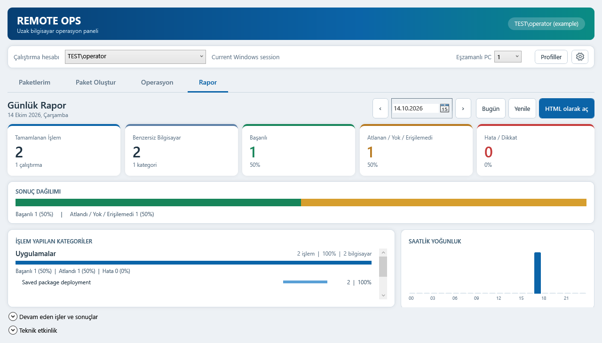

Şekil 4. Güncel günlük rapor; gösterilen iki hedef ve sonuçlar özel geçici alana yazılmış eğitim verisidir.

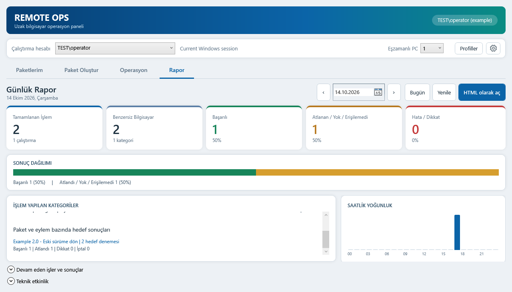

Şekil 4a. Kategori alanı aşağı kaydırıldığında paket/eylem bazında sonuçlar. Bir downgrade hedefi adım sayısı kadar çoğaltılmaz.

| Sonuç | Okuma biçimi |
| --- | --- |
| Success | Tanımlı başarı koşulu geçti; kontrolsüz mod uygulama durumunu kanıtlamaz. |
| Skipped | Bilinçli atlama; nedenini okuyun. |
| Error / Unreachable | Bilinen işlem/erişim sorunu; teknik logu kontrol edin. |
| Cancelled | İptal nedeniyle tamamlanmayan/başlamayan hedef. |
| Indeterminate | Son durum bilinmiyor; hedefte manuel doğrulama. |
| RebootRequired | Reboot gereksinimi; şirket prosedürü ve tekrar tespit. |

Paket sonuç HTML ana tablosu hedef başına tek nihai özet gösterir. ExitCode ve log hedefi son yürütme adımından tamamlanır; ExecutionStep hangi adıma ait olduğunu belirtir. Adım ayrıntıları açılarak kaldırma/kurulum/doğrulama kayıtları görülebilir. CSV ve checkpoint özgün adım satırlarını korur. Nihai Result oluşmadan hata veren hedefler de özetten düşmez. Günlük sayım terminal hedefi bir kez sayar.

Çalışma çıktıları C:\Temp\YD_RemoteOps.App\Logs\Operations\<Operasyon>\<OperationID> altındadır: Results.csv/html, Activity.csv/html, RemoteOps.log ve kaydedilmiş dağıtımda PackageDefinition.json. Workers paralel süreç çıktıları, Detail ara modül raporlarıdır. Paket logları PulledLogs\<PC>\<AdımID_Operasyon> altındadır. Pilot tablosuna OperationID ve rapor yolunu yazın.

## 10. Ayarlar, log ve ekran ölçeği

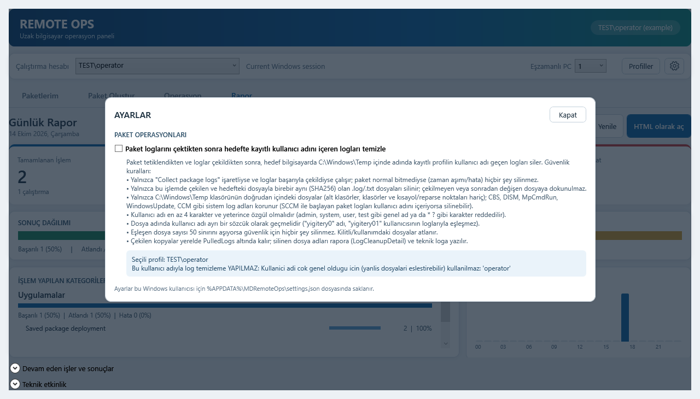

Şekil 5. Paket log temizleme ayarı; toplama ve hedefte temizleme ayrı eylemlerdir.

Paket tanımındaki log toplama yerel PulledLogs alanına dosya çeker. Ayarlardaki temizleme ancak log toplama açıkken ve geçerli kullanıcı adıyla etkinleşir; hedefte kullanıcı adıyla eşleşen loglar için korumalı akış uygulanır. İlk pilotta temizlemeyi kapalı tutmak incelemeyi kolaylaştırır. Activity temizle sadece ekran metnini temizler. Log klasörünü aç yerel logları açar. Saklama/disk temizliği ayrıca planlanır; yedek ve manifestleri ayırmayın.

Toplama C:\Windows\Temp altında son 10 dakikada oluşturulmuş/değişmiş .log/.txt dosyalarını içerir; başka işlemlerin logları da gelebilir. Temizleme sadece başarıyla çekilmiş, hash'i değişmemiş, doğrudan Temp içindeki uygun kullanıcı adlı dosyaları değerlendirir; hata/timeout paketinde temizleme yoktur. DeleteBackups içindeki silme yedekleri modül başlatılınca 7 günden eski LastWriteTime için temizlenebilir; uzun süreli kurtarma kopyası ayrıca tutulmalıdır.

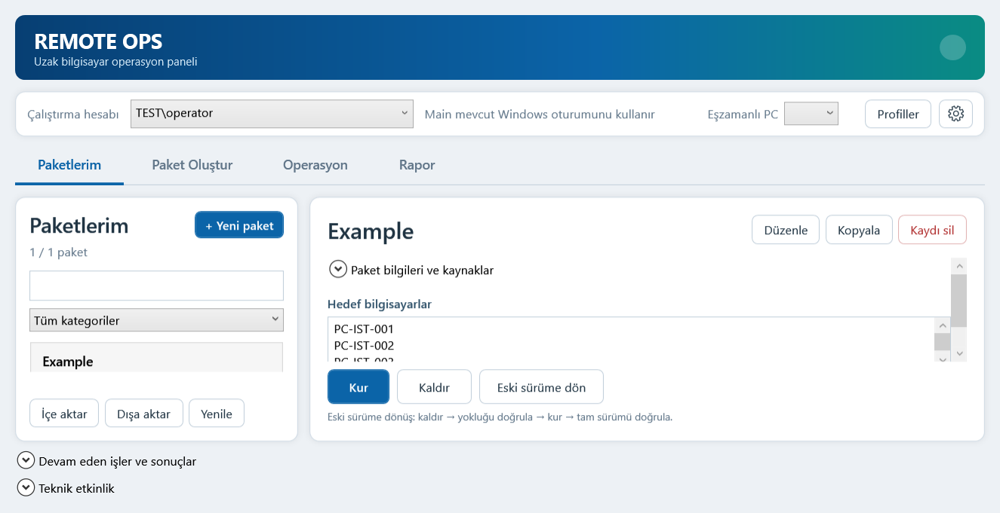

Şekil 6. Yüzde 125 kısa ekran testi; ayrıntı kaydırılır, alt eylemler görünür kalır. Şirket ekranında 1366x768 ve kullanılan ölçekte tekrar kontrol edin.

Pilot sırası: tek hedef salt okunur tespit; kayıt/kopya/export/import; Kur; Kaldır; yeni sürümde downgrade; erişim/kimlik hataları; reboot kodları; Durdur/Zorla durdur; küçük çok hedefli çalışma. Her senaryoda ilk/son sürüm, exit code, OperationID ve rapor yolu kaydedilir. Yerel doğrulama durumu [inceleme raporunda](INCELEME_RAPORU.md) bulunur.

## 13. Güvenilirlik denetimi sonrası notlar

Main profilini silmek başka bir hesabı mevcut Windows oturumu hesabına dönüştürmez; kalan kayıt kendi credential profili olarak kalır. Bozuk JSON alanları içe aktarımda reddedilir. Kategori değiştirilince filtre geçersiz kalırsa Tüm kategoriler görünümü doğru yenilenir. Beklenmedik biten paket işinde sonuçlar çalışıyor görünmez; belirsiz/hata durumunu ve kısmi raporu kontrol edin. Registry/servis değişikliklerinde geri alma dosyası yazılamıyorsa işlem yapılmaz. Test raporu INCELEME_RAPORU.md/PDF içindedir.

## 14. Erişim ön kontrolü ve toplanan loglara erişim

Bütün operasyonlarda her hedefe işlem yapılmadan önce mevcut çalışma hesabıyla gerekli bağlantı kontrol edilir. Dosya işlemleri SMB admin$ paylaşımına salt okunur erişimi; registry işlemleri root\default, servis/görev/süreç işlemleri root\cimv2 yönetim bağlantısını sınar. Kayıtlı paketlerde kontrollü işlemler SMB ve yönetim bağlantısını, kontrolsüz script tetikleme yalnızca SMB bağlantısını gerektirir. Ping ön koşul değildir. Bağlantı kurulamayan hedefte işlem çalıştırılmaz; sarı Atlandı - Erişilemedi sonucu üretilir ve sonraki hedefe geçilir. Yetki reddi ve tanınmayan bağlantı hataları kırmızı hata kalır. Ön kontrolün başarısı sonraki işlemin başarılı olacağını garanti etmez; kaynak, PsExec/SYSTEM ve uygulama kontrolleri kendi akışlarında devam eder.

Log toplama açık ve paket tetiklenmişse, yeni paket çalıştırmalarının logları PulledLogs\<ÇalıştırmaID>\<Bilgisayar>\<AdımID_Operasyon> altında tutulur. Downgrade kaldırma/kurma adımları aynı çalıştırma ve bilgisayar klasöründe ayrı alt klasörlerdir. Diğer dosya operasyonları ve geçmiş log klasörleri mevcut konumlarında kalır.

Devam eden işler ve sonuçlar alanındaki Toplanan loglar düğmesi seçili çalıştırmanın klasörünü açar. Bilgisayar satırındaki Logları aç yalnızca ilgili çalıştırma/bilgisayar klasörüne gider. Dosya yoksa düğme pasiftir; Log durumu toplanmadı, log bulunamadı veya toplama başarısız bilgisini gösterir. Kısmi dosyalar varsa mevcut dosyalar açılabilir ve toplama hatası ayrıca gösterilir. Tüm çalışmalar seçiliyken üst düğme kapalıdır; bilgisayar satırlarındaki kısayollar kullanılabilir. Yeni kısayollar yeni çalıştırma düzeni içindir; önceki sürümdeki loglara Log klasörü/dosya gezgini ile erişilir.

## 15. Eski paket kayıtlarının yeni tanıma geçişi

Yeni kayıt biçimi RemoteOps.Package/2, dışa aktarım biçimi RemoteOps.PackageExport/2'dir. Eski /1 kayıtları ve dışa aktarımları okunabilir. Önceden downgrade etkinse eski Install ve TargetVersion bilgileri ayrı Downgrade ve DowngradeVersion alanlarına kopyalanır; böylece önceki çalıştırma anlamı korunur. Okumak dosyayı değiştirmez; yeniden kaydetmek revizyon artırarak /2 biçimini yazar. Taşınan yolları kontrol edip normal Kurulum alanını güncel sürüme, Eski sürüm alanını gerçekten dönülecek pakete göre düzenleyin. Yeni /2 dosyaları eski uygulama kopyasıyla kullanılmamalıdır; uygulama klasörünü birlikte güncelleyin. Yeni tanımda downgrade için normal Kurulum zorunlu değildir; Kaldırma ve Eski sürüm tanımları zorunludur.

## 16. Operasyon giriş örnekleri ve çekilen dosyalar

Dosya, registry, görev, servis ve süreç alanlarının altında kısa örnekler bulunur. Bunlar açıklamadır; gerçek girdi ve onay kutularına otomatik değer yazılmaz. Servis için görünen ad yerine Name, süreç sonlandırma için önce sorgulayarak doğrulanan PID/tam ad, registry için kökü içeren yol ve ayrı değer adı girilir; köksüz yol HKLM kabul edilir. Görev silmede Task folder ayrı alandır; görev çalıştırmada aynı ad belirsizse işlem reddedilir.

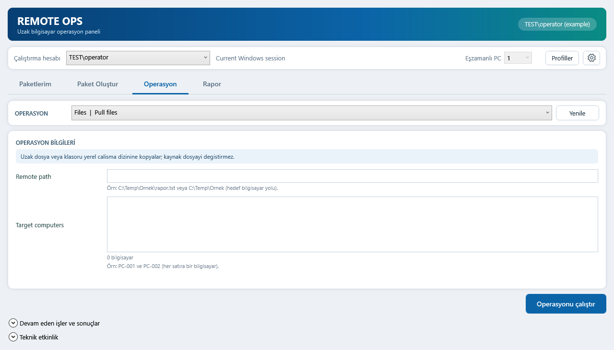

Yeni dosya çekimleri PulledFiles\<ÇalıştırmaID>\<Bilgisayar> altında saklanır. Üstteki Çekilen dosyalar düğmesi seçili çalıştırmanın klasörüne gider. Satırdaki Çekileni göster tek dosyayı Explorer içinde seçer, birden fazla dosyada ilgili istemci klasörünü açar. Dosya yoksa düğme pasiftir; Tüm çalışmalar görünümünde üst düğme kapalı, satır kısayolları kullanılabilir. Script/exe dosyaları kısayol üzerinden otomatik çalıştırılmaz. Eski sürüm çekimlerinin klasör düzeni yerinde kalır.

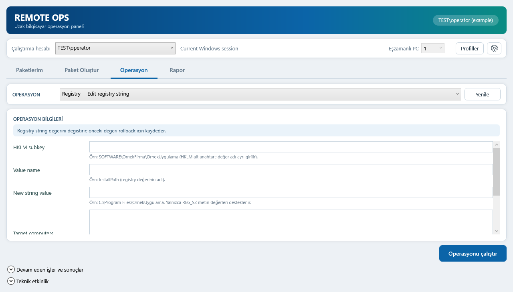

v10 yerel canlı test ayrıntıları [canlı test raporunda](CANLI_TEST_RAPORU.md) bulunur. Canlı test scripti normal otomatik test turuna dahil değildir; yalnızca açık -RunLive ile çalışır, yönetici yetkisi ister ve kendi geçici kaynaklarıyla sınırlıdır.

## 17. v11 erişilebilirlik ve kişisel script paketleri

Erişilemeyen hedefler Devam eden işler ve sonuçlar tablosunda sarı gösterilir; Rapor ve HTML özetlerinde Atlanan / Yok / Erişilemedi grubuna eklenir. CSV ve günlük kayıtlar teknik Unreachable sonucunu korur. Yetki reddi, kaynak hatası, başarısız script çıkışı ve doğrulama hatası kırmızı kalır; belirsiz sonuç/yeniden başlatma durumları ayrıca Dikkat olarak izlenir. Hiçbir hedef sonuç listesinden sessizce çıkarılmaz.

Kişisel script için paket adı ve kategori (örneğin Kişisel scriptler) girin, Kurulum işlemini etkinleştirin ve Kontrolsüz tetikle seçin. Hedef sürüm ile uygulama kimliğini boş bırakabilirsiniz. UNC klasörünü ve .bat/.cmd/.ps1/.vbs dosya adını girip kaydedin; Paketlerim > Kur ile çağırın. Bu mod uygulamanın kurulu olduğunu veya sürümünü doğrulamaz; script sonucunu değerlendirir. Script mevcut uzak çalışma mekanizmasında SYSTEM hesabıyla yürütülür; kullanıcı masaüstü etkileşimi beklememelidir.

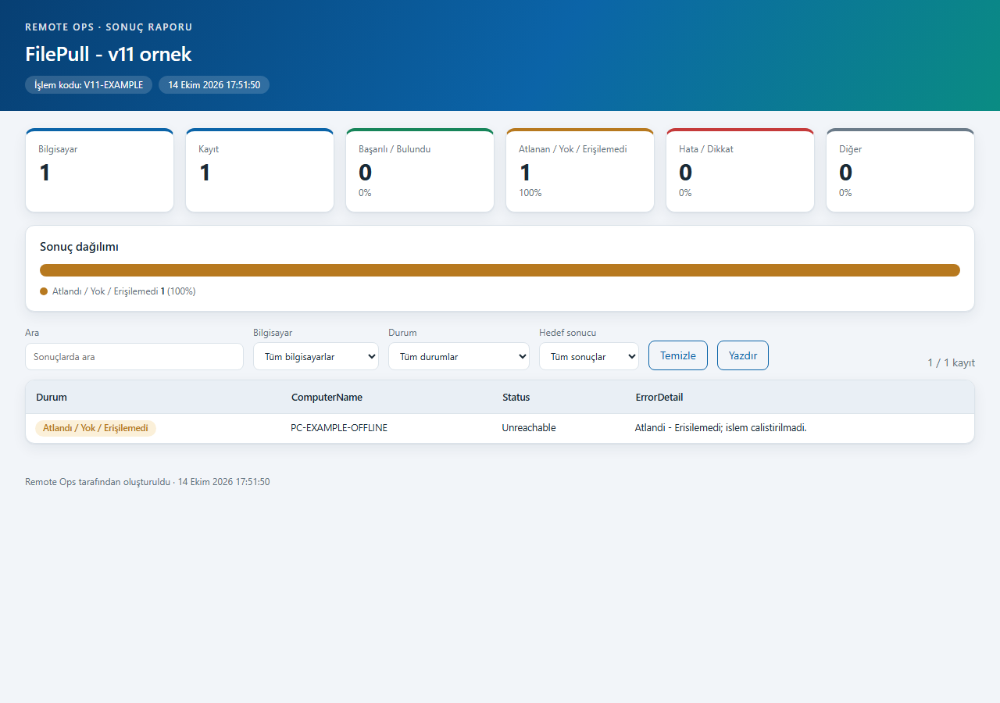

Her tamamlanan değişiklik tesliminde dağıtım sürümü bir artırılır, VERSION.json ve belgeler güncellenir ve yeni sürüm ZIP olarak Drive'a eklenir. Önceki sürüm korunur.

## v12: Dosya yedeğini listeden seçme

Files > Restore file backup ekranında Backup alanını açın. Her seçenek yedeğin tarih/saatini, bilgisayar adlarını, özgün dosya yollarını ve işlem klasörünün kimliğini gösterir. Bir işlemde birden çok bilgisayar veya dosya varsa hepsi aynı seçenekte listelenir. Liste en yeni yedek üstte olacak şekilde sıralanır; ilk yedek başlangıçta seçilir.

Hedef bilgisayarları girin ve RESTORE yazarak onaylayın. Geri yükleme mevcut dosyaların üzerine yazabilir. Yeni bir yedek aldıysanız Refresh modules ile listeyi yenileyin veya başka operasyona geçip geri dönün. Yedek bulunmazsa liste devre dışı kalır ve işlem başlatılamaz. Seçilen yedek sonradan silinirse başka yedek otomatik seçilmez; listeyi yenileyin.

## v13: Registry yolları ve rollback listeleri

Registry okuma, string düzenleme ve silme ekranları HKLM\Software\Firma veya HKEY_LOCAL_MACHINE\Software\Firma biçimlerini kabul eder. HKLM:\Software\Firma, HKCU\Software\Firma, HKEY_CURRENT_USER\Software\Firma, HKU\<SID>\Software\Firma ve HKEY_USERS\<SID>\Software\Firma yolları da desteklenir. Kök belirtilmezse önceki davranış korunur: HKLM kullanılır. Değer adı ayrı alana yazılır. Bu v13 bölümündeki REG_SZ sınırı v14 ile kaldırılmıştır; güncel tür kullanımı v14 bölümündedir.

HKCU, hedef bilgisayarda oturum açmış kullanıcı demektir. Uygulama etkileşimli oturumları bulur ve tekil kullanıcı SID'sini HKU altında kullanır. Kullanıcı yoksa, birden fazla farklı kullanıcı bulunursa veya kullanıcı hive erişimi başarısızsa işlem hata verir; açık HKU\<SID> yolu kullanılmalıdır. Kullanıcının registry hive'ı yüklü olmalıdır. Profil yükleme veya kullanıcı değiştirme yapılmaz.

Registry > Rollback registry change ve Services > Rollback service/task change ekranlarında artık manifest yolu yazılmaz. Tarih, bilgisayar ve değişiklik özetine göre listeden seçim yapılır. Refresh modules listeyi yeniler. Her seçenek bir manifest içindeki tüm kayıtları özetler; çalıştırma yalnızca girilen hedefleri kapsar. Liste boşsa işlem başlatılamaz. Seçilen manifest silinirse başka kayda geçilmez.

Registry özeti geri alma yönünü gösterir: HKEY_LOCAL_MACHINE\Software\Firma [Mode] | "new" -> "old". Silme sonrası geri almada [absent] -> "old"; oluşturulan değeri geri almada "new" -> [absent] gösterilir. "" boş metin, [absent] ise değerin hiç bulunmaması demektir. Özet manifestteki kayda dayanır, canlı registry okuması değildir; hedefte sonradan yapılan değişiklikleri göstermez. HKCU işleminin geri alınması, o anda oturum açan yeni kullanıcıyı değil, kaydedilmiş SID'yi etkiler. Onay alanına yine ROLLBACK yazılır.

Servis rollback seçenekleri servis adını ve başlangıç türü/durum geri dönüşünü gösterir; görev kayıtlarında görev yolu ve eski etkinlik durumu veya XML'den geri yükleme bilgisi yer alır. Eski kayıtta yeni durum bulunmuyorsa [recorded change] gösterilir.

## v14: Türü koruyan registry düzenleme ve geri alma

Registry okuma, düzenleme, silme ve rollback işlemleri REG_SZ, REG_DWORD, REG_QWORD, REG_MULTI_SZ ve REG_EXPAND_SZ türlerini destekler. Okuma türü otomatik bulur. Düzenleme ekranında Auto mevcut türü korur; değer yoksa REG_SZ oluşturur. Yeni bir sayısal, çoklu veya genişletilebilir metin değeri oluşturmak için Value type alanında ilgili türü seçin. Seçilen tür mevcut değerin türüyle uyuşmazsa işlem reddedilir; düzenleme tür dönüşümü yapmaz.

| Tür | Yeni değer girişi |
| --- | --- |
| REG_SZ | Metin; boş metin ve satır sonları korunur. |
| REG_DWORD | İşaretsiz ondalık veya 0x hex; 0–4294967295. |
| REG_QWORD | İşaretsiz ondalık veya 0x hex; 0–18446744073709551615. |
| REG_MULTI_SZ | JSON metin dizisi: ["one","two"]. Tek eleman: ["only"], boş dizi: []. Sıra korunur. |
| REG_EXPAND_SZ | Ham metin: %SystemRoot%\Temp. Ortam değişkenleri genişletilmez. |

Registry rollback listesinde kayıtlı yeni değer -> eski değer ile birlikte yeni tür -> eski tür görünür. Tür korunarak geri yüklenir; önceden bulunmayan değer oluşturulmuşsa geri alma onu kaldırır. DWORD/QWORD sayıları metin olarak hassasiyet kaybetmeden saklanır; REG_MULTI_SZ dizisinin sırası ve boş dizi bilgisi korunur. Özet kayıtlı veridir, canlı hedef sorgusu değildir. Tür alanları olmayan eski manifestler önceki sürümlerin REG_SZ kayıtları olarak okunur.

REG_EXPAND_SZ'nin ham yedeği, Windows Remote Registry erişimi üzerinden alınır. Standart WMI genişletilmiş metin döndürdüğü için yedek amacıyla kullanılmaz. Uzak hedefte Remote Registry erişimi, ilgili servis/ağ erişimi ve okuma izinleri yoksa okuma/düzenleme/silme işlemi hata verir; hiçbir değişiklik yapılmaz. Uygulama servisi kendiliğinden açmaz. Yerel bilgisayarda salt okunur .NET erişimi kullanılır. Diğer türlerin işlemleri mevcut CIM/DCOM kanalını kullanır.

## v15: Geçmiş ve Hata Teşhisi

Geçmiş sekmesine ilk girişte yerel kayıtlar okunur. Tarih aralığı, operasyon, bilgisayar ve sonuç filtrelerini girip Filtrele'ye basın. Tarihler dahil edilir; metinler yazıldığı gibi aranır, yıldız joker değildir. Yenile yeni kayıtları okur. Her sayfada en çok 50 çalışma vardır. Çalışmayı seçtiğinizde hedef sonuçları ve seçili hedefin özgün adımları görünür. Kısa ekranda sağdaki kaydırma çubuğuyla alt bölüme inin.

Çıktı listesinden mevcut klasör, HTML, CSV veya teknik logu seçip Aç'a basın. Hedef logları ve Çekilen dosyalar yalnızca seçili çalışma/bilgisayara bağlı klasör mevcutsa etkindir. Eksik/bozuk dosyalar Okunamayan kayıtlar / eksik çıktılar alanında açıklanır. Yenileme sırasında seçili çalışma mevcut sayfada kaldığında seçim korunur. Eski kayıtların eksik alanları boş olabilir. Hedefsiz genel hata '(çalışma)' olarak gösterilir.

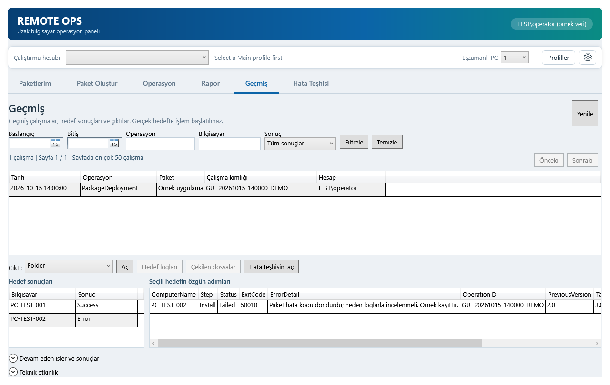

Şekil v15-1. Gerçek WPF arayüzünde yapay test çalışması; şirket işlemi değildir.

Hedefi seçip Hata teşhisini aç'a basın. Hata Teşhisi sekmesinden de çalışma/bilgisayar seçilebilir. Özgün durum, çıkış kodu, hata metni, paket kimliği/revizyonu ve sürümler mevcut oldukları ölçüde gösterilir. Önerilen kontroller kesin kök neden iddiası değildir. 50010 gibi bilinmeyen kodlar aynen korunur. Belirsiz sonuçta uzak işlem hâlâ çalışıyor olabilir; durumu kontrol etmeden tekrar dağıtım başlatmayın. Başarıyla birlikte bildirilen 3010/1641 yeniden başlatma bilgisi ayrıca görünür.

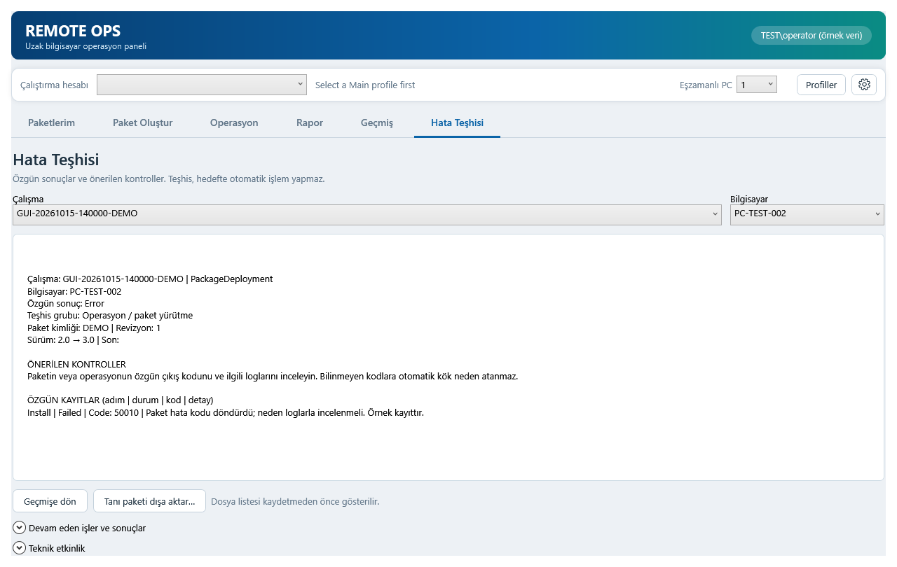

Şekil v15-2. 50010 kodlu örnek sonuç; gerçek şirket ortamındaki neden bu geliştirmeyle belirlenmiş sayılmaz.

Tanı paketi dışa aktar seçili çalışmanın bilinen rapor ve worker loglarını önizler. Listeyi inceleyip yerel ZIP konumunu seçin. Var olan ZIP'in üzerine yazılmaz. Kaynak önizlemeden sonra değişmişse yeniden önizleme gerekir. Profil/parola kataloğu eklenmez; üçüncü taraf logları hassas içerik taşıyabileceğinden paylaşmadan önce inceleyin. Dosya otomatik gönderilmez veya Drive'a yüklenmez.

Bu teslimde uzak hedefte canlı operasyon çalıştırılmadı. Yeni ekranlar yerel fixture kayıtları ve gerçek WPF olaylarıyla doğrulandı. Genel reçeteler, hedef grupları, önizleme ve birleşik geri alma sonraki teslimlerdir.

## v16: Kayıtlı hedef grupları

Hedef Grupları sekmesinde Yeni ile grup adı, açıklama ve bilgisayarları girip Grubu kaydet'e basın. Her satır, boşluk, virgül veya noktalı virgül hedefleri ayırır. Tekrarlar harf büyüklüğünden bağımsız kaldırılır. Grup kaydetmek bilgisayarlara bağlanmaz. Ad, açıklama veya hedefleri değiştirmek için listeden kaydı seçin; Kopya hazırla yeni kayıt taslağı oluşturur ve Kaydet'e kadar diske yazmaz. Grubu sil yalnızca kişisel kaydı kaldırır.

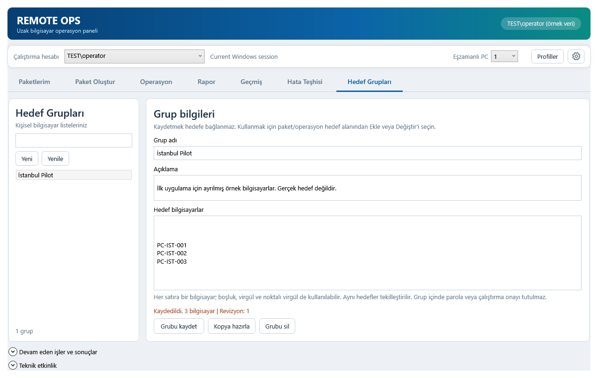

Şekil v16-1. TEST hesabı ve PC-IST isimleri yapay eğitim verisidir.

Gruplar yalnızca bu Windows kullanıcısının kişisel kataloğunda tutulur. Paketlerim ve Operasyon ekranındaki hedef alanından grubu seçin. Seçmek hedefleri değiştirmez: Ekle mevcut listeye birleştirir; Değiştir mevcut hedef listesini seçili grubun hedefleriyle değiştirir. Grupları yenile kayıtları tekrar okur. Grup dışarıda değiştirilmiş/silinmişse eski seçimle aktarım engellenir; yenileyip tekrar seçin. Aktarılan hedefler bağımsız metindir; grup düzenlemesi başlamış işi veya forma aktarılmış listeyi değiştirmez.

ASCII bilgisayar adı, FQDN ve IPv4 kabul edilir. Joker, UNC/dosya yolu, kontrol karakteri, IPv6 veya geçersiz adres kabul edilmez. Bu kontrol DNS/ağ erişiminin kanıtı değildir. Aynı grubu iki pencerede düzenlerseniz eski revizyonla kayıt reddedilir; yenileyip listeden yeniden seçin. Küçük ekranlarda form içindeki kaydırma çubuğunu kullanın. Yönetim sekmesindeki Yenile, seçili kaydın diskteki halini editöre yükler; kaydedilmemiş düzenlemeyi önce kaydedin.

## v16: İşlem öncesi önizleme

Operasyon formunu doldurup Önizle veya Operasyonu çalıştır'a basın. İkisi de önce aynı önizlemeyi açar. Hesap, tekilleştirilmiş hedefler, parametreler, işlem etkisi ve geri alma olanaklarını gözden geçirin. İnceledim, başlat işlemi başlatır; Vazgeç hedefte işlem yapmadan kapatır. Değişiklik operasyonlarındaki mevcut onay sözcüğünü formda yine siz yazmalısınız; önizleme otomatik onay doldurmaz.

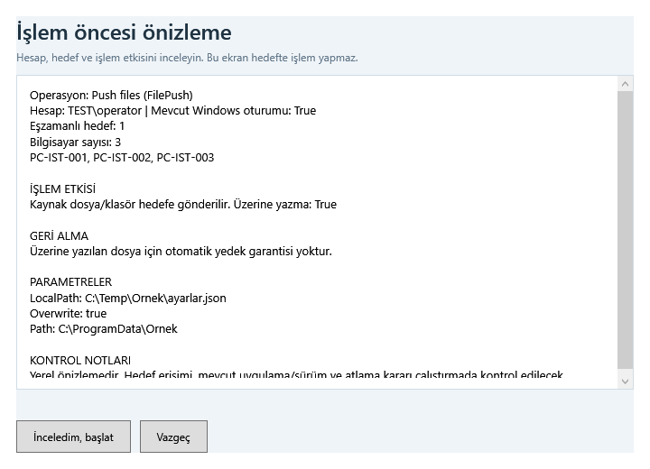

Şekil v16-2. Dosya gönderme önizlemesi; gerçek dosya gönderilmedi.

Paketlerim'de Kur/Kaldır/Eski sürüme dön mevcut Dağıtım özeti panelini açar. Aynı ortak önizleme bilgileri burada gösterilir; TRIGGER/DOWNGRADE girişi ve Dağıtımı başlat düğmesi korunur. Seçilen eylemin ilgili kaynakları ve hedef sürümü gösterilir. Eski sürüme dönüşte normal kurulum kaynağı yerine kaldırma ve eski sürüm kaynakları açıklanır.

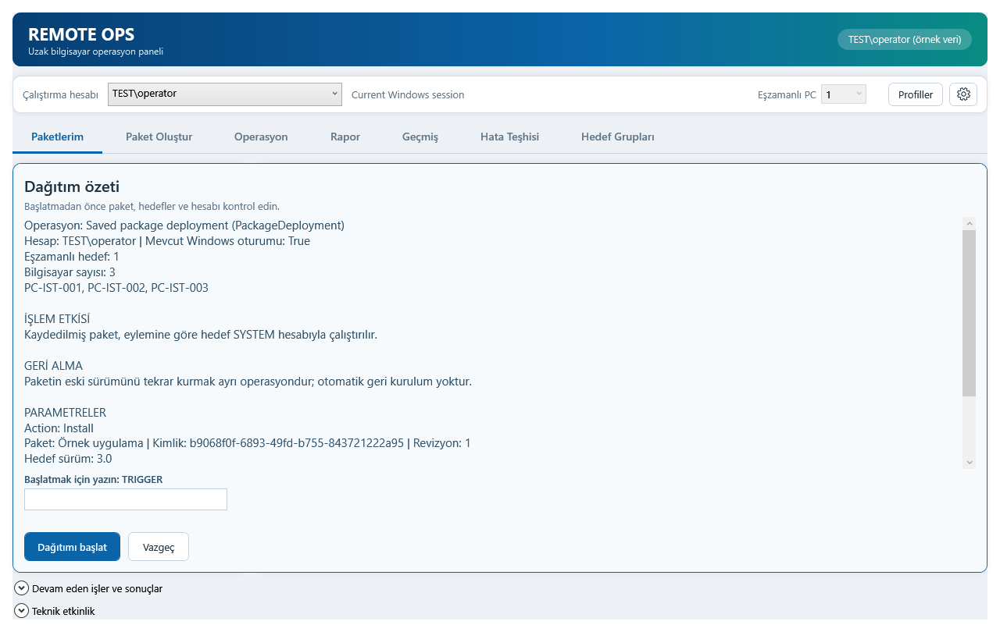

Şekil v16-3. Hesap/hedef/paket ve etki özeti. Uzun içerik kaydırılır; başlatma alanı altta kalır.

Önizleme yereldir: hedefe SMB/WMI/PsExec bağlantısı açmaz; erişim, kurulu sürüm, servis durumu ve hangi hedefin atlanacağı çalıştırmada belirlenir. Hedefte işlemin başarılı olacağı anlamına gelmez. Önizleme açıkken hesap, hedef, işlem, parametre, paket kaydı, paralellik veya log temizleme ayarı değişirse eski özetle başlatma reddedilir. Özeti kapatıp güncel formdan yeniden açın. Paket kaydı silinmişse tekrar seçin. Profil parolası özete yazılmaz; çalıştırma anındaki hesap kontrolleri korunur.

Bu teslimde gerçek şirket hedefinde bağlantı veya mutasyon yapılmadı. Önizleme/grup testleri fixture verileri ve gerçek WPF olaylarıyla yürütüldü. Canlı isteğe bağlı ön kontrol, grup import/export ve merkezi ekip kataloğu bu teslimde yoktur.

## v17 — Birleşik Geri Alma Merkezi

Geri Alma Merkezi sekmesi, DeleteBackups, FileRollbacks, RegistryRollback ve ServiceTaskRollbacks altındaki yerel manifestleri birlikte gösterir. Dosya/klasör geri yükleme, dosya taşıma/değiştirme geri alma, registry, servis ve zamanlanmış görev kayıtları desteklenir. Bir kayıt tek manifest, tek bilgisayar ve tek türdür; aynı kaydın bütün nesneleri kapsam içindedir. Farklı çalışmalar birleştirilmez. Süreç sonlandırma ve görev çalıştırma geri alınabilir gösterilmez.

Bilgisayar, tür, kullanılabilirlik ve tarih aralığıyla filtreleyin; sayfa başına 50 kayıt görünür. Bitiş tarihi günün tamamını kapsar. İlk sekme açılışı ve Yenile yerel dosyaları okur; arka planda sürekli tarama veya hedef sorgusu yapılmaz. Yerel yedeğin bulunması, hedefe erişim veya güncel durum garantisi değildir. Eksik/bozuk yedekler açıklamalarıyla görünür ve başlatılamaz.

Kaydı seçip Geri almayı önizle düğmesini kullanın. Gerçek çalıştırma hesabı, bilgisayar, bütün nesneler ve kaydedilen eski durum gösterilir. Dosya geri yüklemede RESTORE, diğer türlerde ROLLBACK sözcüğünü yazarak İnceledim, başlat düğmesine basın. Vazgeç işlemi başlatmaz. Önizleme sonrası hesap, ilgili ayarlar, manifest, kayıt kapsamı veya gerekli yedeğin kontrol edilen kimliği değişirse yeniden önizleme gerekir. Runner hedefte değişiklikten önce seçimi tekrar doğrular; liste sıra numarası kullanılmaz.

Dosyalar geri kopyalanırken aynı adlı hedeflerin üzerine yazılabilir. Klasör geri yükleme hedefteki fazladan dosyaları silmez. Dosya taşıma geri almada kaynak, manifestte kaydedilen taşınmış konumdur. Registry türü ve kaydedilmiş HKU SID yolu korunur; eksik değer ile açıkça kaydedilmiş boş metin ayrılır. Servislerde kaydedilen eski durum/başlangıç türü uygulanır. Silinen görev XML yedeğinden oluşturulur, aynı adlı mevcut görev ezilmez. DTD ve dış kaynak çözümleme kapalıdır.

Bu sürüm tümünü geri al, otomatik zincir, otomatik tekrar deneme veya nesne bazında kapsam daraltma içermez. Mevcut Operasyon sekmesindeki geri alma girişleri korunur. Çalıştırma çıktıları mevcut rapor ve Geçmiş akışına gider. Uzun ömürlü dosya yedeklerinin bütün içerikleri indekslemede hash'lenmez; manifest SHA-256 ve yedek meta verisi, görev XML hash'i, yol ve reparse kontrolleri uygulanır. Bu, dosya yedeğinin tamamına kriptografik bütünlük veya işlem atomikliği garantisi vermez.

Görseller yerel fixture verileridir. v17 kapsamında gerçek şirket bilgisayarında uzak geri alma testi yapılmamıştır. Sürüm ayrı klasörde ve doğrulanmış ZIP ile teslim edilir; bu aşamada Drive yüklemesi yapılmaz.

## v18 — Operasyon reçeteleri

Dokuzuncu sekme Operasyon Reçeteleri, servis/dosya/registry/paket adımlarını sıralı bir kişisel tarifte birleştirir. Yeni ile ad/açıklama girin; Adım ekle ile 1–20 işlem oluşturun. Adımı seçip alanlarını düzenleyin, Yukarı/Aşağı ile sıralayın ve Kaydet kullanın. Sağ panel bütünüyle kaydırılır; küçük ekranda alt bölümdeki kaydetme ve çalıştırma alanlarına kaydırarak erişilir. Kopyala yeni kimlikli taslak hazırlar; Tanımı sil yalnız kişisel tarifi kaldırır.

İlk izin listesi: servis listeleme/kontrol/başlangıç türü; dosya gönderme/karşılaştırma/yedekli silme; registry okuma/düzenleme/silme ve kayıtlı paket dağıtımı. Serbest kod, eklenti, iç içe tarif, koşullu dal ve adımlar arası çıktı değişkeni yoktur. Reçeteler %APPDATA%/MDRemoteOps/Recipes altında şema/revizyonla tutulur. Hesap, hedefler, parola ve çalıştırma onayı tanımda saklanmaz.

Kayıtlı paketin tam tanımı reçeteye kopyalanır. Paket kataloğu sonradan değişirse eski reçete sessizce değişmez; güncellemek için adımda paketi yeniden seçip reçeteyi kaydedin. Hedefleri çalışma alanında yazın veya hedef grubunu Ekle/Değiştir ile kullanın. Reçeteyi önizle hesabı, hedefleri, sıralı bütün parametreleri ve etkileri gösterir. Her yeni çalıştırmada RECETE yazılır. Kaydedilmemiş düzenleme, değişmiş kayıt/hesap/hedef/ayar eski önizlemeyi geçersiz kılar.

Bilgisayarlar sırayla, her bilgisayarın adımları sırayla çalışır. Normal bir adım hatasında o bilgisayarın kalan adımları NotRun olur; sonraki bilgisayara geçilir. Dosya karşılaştırmada Farkli veya Bulunamadi zinciri durdurur. Dosya gönderirken atlanan dosyalar tamamlanmış sayılmaz. Servis listesinde eşleşme olmaması veya registry okumada değerin yokluğu bilgi olarak korunabilir; yazma hatasıyla karıştırılmaz. Paketin doğrulanmış zaten mevcut/yok/hedefte atlaması devam edebilir; genel Skipped devam izni değildir. Yeniden başlatma gereksinimi zinciri durdurur.

Durdur isteği bütün yeni adım/hedefleri engeller; aktif alt adımın sonucu beklenir. Zorla durdurmak yerel süreç ağacını sonlandırır; uzak işlemin durduğunu garanti etmez. Sonucu bilinmeyen aktif adım Indeterminate olarak, özgün adım ve bilgisayar kimliğiyle kaydedilir. Otomatik retry/resume/reboot/rollback yapılmaz.

Bir alt adım 7200 saniyelik bekleme eşiğini aşarsa yeni işler engellenir ve aktif yerel süreç takip edilmeye devam edilir. Süreç kendiliğinden bitene veya kullanıcı açıkça zorla durdurana kadar çalışma görünür kalır; başka hedefe gizlice geçilmez. Geçerli geç sonuç özgün satırlarda korunur; eşiği aşan reçete otomatik devam etmez. Bu eşik uzak işlemi otomatik öldüren bir süre sınırı değildir.

Uygulama yeniden açıldığında yalnız kesilmiş reçete checkpoint'leri yerel rapora dönüştürülür. PID ve süreç başlangıç zamanı hâlâ eşleşen Runner'a dokunulmaz. Başlamış fakat tamamlandığı kanıtlanamayan adım belirsizdir; başlamamış adımlar NotRun olur. Bu işlem hedefte reçeteyi sürdürmez ve ayrı yarım kalan işler merkezi eklemez.

Geçmişte reçete tek üst çalışma olarak görünür. Paket / reçete sütunu tarif adını gösterir; hedef başına tek terminal sonuç ve ayrıntıda özgün adım kimlikleri/çıktıları vardır. Alt süreçler günlük ledger'a ayrı çalışmalar eklemez. Teşhis özgün hata/exit code bilgisini korur. Servis/registry/yedekli silme manifestleri mevcut Geri Alma Merkezi'nde bulunabilir; tüm reçeteyi tek eylemle geri alma yoktur.

Dosya gönderme aynı adlı içeriği ezebilir ve otomatik yedek/geri alma sağlamaz. Örneğin servis durdurulduktan sonraki dosya adımı hata verirse sonraki servisi başlat adımı çalışmaz; önceki değişiklikler otomatik geri alınmaz. Yerel önizleme canlı hedef durumunu veya kaynak erişimini garanti etmez. Üst ve alt istekler 22000 Base64 karakter sınırına tabidir; çok büyük tarif açık hatayla reddedilir, kesilerek çalıştırılmaz.

Doğrulamalar yerel fixture, sahte uzak çağrılar ve gerçek WPF/Runner süreçleriyle yapıldı. v18 için gerçek şirket hedefinde canlı işlem yapılmadı. Dağıtım v18 klasörü ve doğrulanmış ZIP'tir; v17 korunur, Drive yüklemesi yapılmaz.

## v19 — Rapor okunabilirliği

Türkçe metinlerin Windows PowerShell 5.1 altında bozulmasına yol açan kaynak kodlaması düzeltildi. Yeni raporlarda sütunlar okunabilir genişlikte kalır; dar ekranda tablo yatay kaydırılır. Teknik kimlikler, hash ve revizyon alanları satırdaki **Ayrıntı → Teknik kimlikler** bölümündedir. Arama bu alanları da kapsar. CSV özgün alanlarını korur; çalıştırılmayan adımlar ekranda **Çalıştırılmadı** olarak görünür.

Düzeltme yeni üretilen raporlar içindir. Önceden bozulmuş HTML/CSV kayıtları otomatik değiştirilmez.

73/73 yerel test geçti; gerçek Edge ile normal ve yüzde 125 ölçek, ayrıntı, arama, sıralama ve yazdırma kontrol edildi. Bu teslimde canlı uzak hedef testi ve Drive yüklemesi yapılmadı.

[Ayrıntı görünümü](screenshots-v19/rapor-ayrinti.png) · [Yüzde 125 görünümü](screenshots-v19/rapor-125.png) · [Doğrulama](V19_VALIDATION.json)

## v20 — Teşhis seçimi ve görev yedeği kodlaması

Hata Teşhisi çalışma listesinde operasyon adı, tarih/saat ve kayıtlıysa paket/reçete adı görünür. Örnek: **Paket dağıtımı · Örnek paket · 15.10.2026 13:58:32**. Teknik çalışma kimliği teşhis ayrıntısında korunur; seçim yine aynı kayıt nesnesine bağlıdır.

Görev silmeden önce alınan XML yedeğinde UTF-16 bildiriminin UTF-8 dosya baytlarıyla uyuşmaması Geri Alma Merkezi okumasını engelliyordu. Eski UTF-8 yedekler dosyaya yazılmadan okunur; gerçek BOM içeren UTF-16 yedekler de desteklenir. Yeni yedekler XML yazıcısıyla tutarlı UTF-8 olarak kaydedilir. DTD ve dış kaynak çözümleme yasakları, hedef kapsamı ve mevcut görevin üzerine yazmama kontrolleri korunur.

Bu hata daha önce geri alma yapılmış olmasına bağlı değildir. Önceden geri yüklenmiş görev hedefte mevcutsa tekrar geri alma işlemi mevcut görev üzerine yazmaz. Dosyanın okunabilmesi hedefte geri alma başarısı garantisi değildir.

Doğrulama yerel dosya örnekleri, sahte uzak sınırlar ve gerçek WPF çizimiyle yapılmıştır. Bu teslimde canlı uzak görev değiştirilmedi; Drive yüklemesi yapılmadı.

[Yüzde 125 görünümü](screenshots-v20/hata-teshisi-125.png) · [v20 doğrulaması](V20_VALIDATION.json)

## v21 — Anlaşılır teşhis ve geri alma durumları

Hata Teşhisi ekranında teknik ayrıntıların üstünde **Neden oldu?** ve **Ne yapmalıyım?** açıklamaları gösterilir. Bilinen sürüm atlama mesajı açıkça açıklanır; genel atlama veya bilinmeyen hata için kanıtsız bir neden atanmaz. Yetki/kaynak/doğrulama sınıfları kayıt işaretleridir; kesin kök neden iddiası değildir.

Geri Alma Merkezi yerel yedek durumu, eşleşen yerel geri alma geçmişi ve hedefin güncel durumunu ayrı gösterir. Eksik dosya veya okunamayan görev XML'i anlaşılır başlıkla belirtilir; özgün hata ayrıntıda kalır. Listeye bakmak hedefe bağlantı kurmaz. **Hedefin güncel durumu sorgulanmadı** ifadesi bu nedenle gösterilir.

v21 itibarıyla Geri Alma Merkezi üzerinden tamamlanan denemeler, çalışma raporu yanında **RecoveryReceipt.json** yerel sonuç kaydı üretir. Eşleştirme bilgisayar, kayıt kimliği, manifest özeti, yedek damgası, tür ve seçilmiş satır anahtarlarıyla yapılır. Kayıtlardaki başarı güncel hedef durumunun doğrulandığı anlamına gelmez. Eski çalışmalar ve diğer yollardan yapılan geri almalar için eşleşen kayıt bulunmayabilir; kayıt yokluğu hiç geri alınmadığını kanıtlamaz. Manifest veya yedek değişirse eski sonuç yeni kapsamın sonucu olarak gösterilmez.

**Son geri alma: başarılı bildirildi** yalnızca seçili kapsama ait yerel sonuçların başarı bildirdiğini söyler. Eksik/başarısız sonuçlarda tam başarı doğrulanmadığı belirtilir. Sonuç kaydı yazılamazsa uyarı kaydedilir; asıl uzak işlem sonucu değiştirilmez. Bu dosyalar yerel operatör kaydıdır, imzalı denetim kanıtı değildir.

[Eksik yedek görünümü](screenshots-v21/geri-alma-eksik.png) · [Yüzde 125 görünümü](screenshots-v21/geri-alma-125.png) · [Doğrulama](V21_VALIDATION.json)

Ekranlar örnek verilerle gerçek WPF çizimidir. Testler yerel örnekler ve sahte uzak sınırlar kullanır; bu teslimde canlı uzak hedef değiştirilmedi. Drive yüklemesi yapılmadı. Önceki dağıtım korunur.
