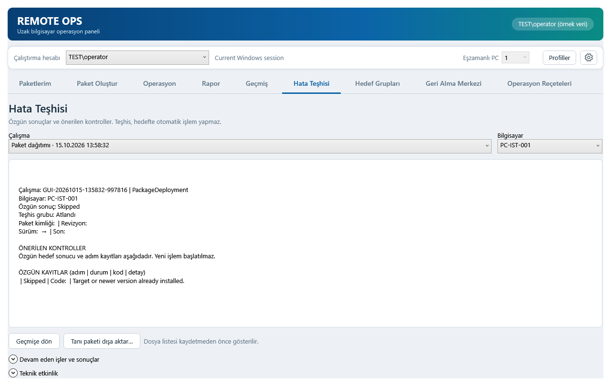

# v20 inceleme ve doğrulama

## v20 — Teşhis seçimi ve görev yedeği kodlaması

Hata Teşhisi çalışma listesinde operasyon adı, tarih/saat ve kayıtlıysa paket/reçete adı görünür. Örnek: **Paket dağıtımı · Örnek paket · 15.10.2026 13:58:32**. Teknik çalışma kimliği teşhis ayrıntısında korunur; seçim yine aynı kayıt nesnesine bağlıdır.

Görev silmeden önce alınan XML yedeğinde UTF-16 bildiriminin UTF-8 dosya baytlarıyla uyuşmaması Geri Alma Merkezi okumasını engelliyordu. Eski UTF-8 yedekler dosyaya yazılmadan okunur; gerçek BOM içeren UTF-16 yedekler de desteklenir. Yeni yedekler XML yazıcısıyla tutarlı UTF-8 olarak kaydedilir. DTD ve dış kaynak çözümleme yasakları, hedef kapsamı ve mevcut görevin üzerine yazmama kontrolleri korunur.

Bu hata daha önce geri alma yapılmış olmasına bağlı değildir. Önceden geri yüklenmiş görev hedefte mevcutsa tekrar geri alma işlemi mevcut görev üzerine yazmaz. Dosyanın okunabilmesi hedefte geri alma başarısı garantisi değildir.

Doğrulama yerel dosya örnekleri, sahte uzak sınırlar ve gerçek WPF çizimiyle yapılmıştır. Bu teslimde canlı uzak görev değiştirilmedi; Drive yüklemesi yapılmadı.

[Yüzde 125 görünümü](screenshots-v20/hata-teshisi-125.png) · [v20 doğrulaması](V20_VALIDATION.json)

Regresyon testi önce özgün Unicode BOM hatasıyla başarısız oldu; düzeltmeden sonra geçti. UTF-8 BOM, BOM olmayan UTF-8, gerçek UTF-16, Türkçe karakter, değişmeyen eski dosya hash değeri, yeni yedeğin doğrudan XmlDocument.Load ile okunması ve DTD reddi kontrol edildi.

Bağımsız statik kod incelemesinde açık bulgu kalmadı. Yeni XML yardımcısını çağıran eski AST tabanlı test düzeneğine Recovery bağımlılığı eklendi; XML karşılaştırması belge bildiriminin baytları yerine görev içeriğini karşılaştırıyor. İlk tarama ve düzeltilen testlerin son tekrar kayıtları ayrı saklanır. Gerçek uzak hedefte görev silme/geri yükleme bu teslimde denenmedi.
